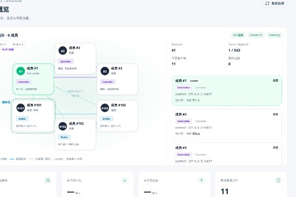

# lyrnormq

Rust MQTT broker for MQTT 3.1.1 and MQTT 5.0 — QoS 0/1/2, retained, Will, shared subscriptions — over TCP, TLS/mTLS, and WS/WSS, with durable sessions, rule-driven egress, multi-node cluster, and an embedded Dashboard.

<p align="center">
  <a href="docs/images/dashboard-overview.png">
    
  </a>
</p>

**Full MQTT conformance and production readiness are not claimed.** See the [conformance matrix](docs/conformance/README.md).

## Core capabilities

- **MQTT 3.1.1 + 5.0** — Clean Start / Session Expiry, Receive Maximum, Topic Alias, Subscription Identifier & options, Message Expiry, Will Delay, `$share`; unsupported semantics are refused, not silently dropped
- **Transactional sessions** — SessionEngine + outbox commit before ACK / first write; optional SQLite keeps subscriptions, offline QoS 1/2, retained and Wills across restarts
- **Cluster** — Controller Raft for metadata, local route replicas on each Broker, direct broker-to-broker publish RPC (no Controller hop on the data path), and memory data replicas for session/outbox state including retained, Will, and `$share`
- **Rules → durable egress** — SQL-matched events land once in a segmented journal, then Webhook / Kafka with per-client FIFO and restart-safe retries (MQTT ACK is not remote delivery)
- **Transports & access** — TLS, mTLS, WS/WSS; Argon2 local ACL, optional MQTT 5 PLAIN; PostgreSQL / HTTP auth options; privileged HTTP publish
- **Bounded runtime** — typed errors, finite queues and handshake admission; no `unsafe` / `unwrap` / `expect` on production paths; structured tracing and in-process management UI

## Quick start

Configuration is a TOML file (default `lyrnormq.toml`). CLI flags for listen / TLS / auth are gone — only `--config` and a few cluster maintenance commands remain. Full field list and `LYRNORMQ_*` overrides: [lyrnormq.toml.example](lyrnormq.toml.example).

```sh
# Build the embedded Dashboard UI (Node needed only on the build host).
(cd dashboard/web && npm ci && npm run build)
cargo build --workspace

# Minimal standalone config (omit [cluster]):
cat > lyrnormq.toml <<'EOF'
[node]
id = 1
data_dir = "./data"

[mqtt]
listen = "127.0.0.1:1883"
protocol = "both"
EOF

cargo run -p lyrnormq
# or: cargo run -p lyrnormq -- --config ./lyrnormq.toml
```

Standalone sessions land in `data_dir/sessions.sqlite`. Rules / access / egress use `data_dir/rules.sqlite`, `access.sqlite`, and `egress`. Do not point two processes at the same `data_dir`. Cluster setup: [docs/cluster/running.md](docs/cluster/running.md).

```sh
lyrnormq --config /opt/lyrnormq/lyrnormq.toml
lyrnormq cluster-status --config /opt/lyrnormq/lyrnormq.toml
```

## Transports

Enable TLS / mTLS / WebSocket in the same TOML (public MQTT listen addresses require `[mqtt.tls]`):

```toml
[mqtt]
listen = "0.0.0.0:8883"
protocol = "both"

[mqtt.tls]
cert = "./server-chain.pem"
key = "./server-key.pem"
client_ca = "./clients-ca.pem"   # omit to keep server-only TLS

[mqtt.websocket]
path = "/mqtt"                   # omit the whole table for plain TCP/TLS
```

WS clients must offer the `mqtt` subprotocol and use binary frames. One process serves one MQTT listener. Contracts: [TLS](docs/contracts/phase4c-tls.md) · [mTLS](docs/contracts/phase4e-admission-mtls.md) · [WS/WSS](docs/contracts/phase4d-websocket.md)

## Authentication

No `[auth]` table → open anonymous access. With a policy file, unlisted users/actions are denied:

```sh
read -r -s MQTT_PASSWORD
printf '%s' "$MQTT_PASSWORD" | cargo run -q -p mqtt-auth --example hash_password
unset MQTT_PASSWORD
```

```json
{
  "allow_anonymous": false,
  "users": [{
    "username": "alice",
    "password_hash": "<generated Argon2id PHC>",
    "client_id_prefix": "alice-",
    "publish": ["tenant/alice/#"],
    "subscribe": ["tenant/alice/#"]
  }]
}
```

```toml
[auth]
policy = "./policy.json"
plain = true    # optional MQTT 5 enhanced AUTH PLAIN
```

Use TLS for wire confidentiality. Also: [PostgreSQL auth](docs/postgres-auth.md), [HTTP auth](docs/http-auth-api.md).

## Verification

```sh
python3 -m venv /tmp/lyrnormq-client-venv
/tmp/lyrnormq-client-venv/bin/pip install paho-mqtt==2.1.0
cargo fmt --all -- --check
cargo clippy --workspace --all-targets -- -D warnings
(cd dashboard/web && npm ci && npm run build)
cargo test --workspace
RUSTDOCFLAGS='-D warnings' cargo doc --workspace --no-deps
python3 tests/blackbox.py
# More suites under tests/ (MQTT5, auth, persistence, Paho, …)
```

Set `LYRNORMQ_TEST_STORAGE_PATH` for durable-mode suites. CI runs volatile and SQLite modes.

## Documentation

| Topic | Link |
| --- | --- |
| Architecture | [docs/architecture.md](docs/architecture.md) |
| Cluster | [phase7a](docs/contracts/phase7a-cluster.md) · [memory replicas](docs/contracts/phase7f-memory-replicas.md) |
| Conformance | [docs/conformance/README.md](docs/conformance/README.md) |
| Dashboard | [docs/dashboard.md](docs/dashboard.md) |
| Rules / Webhook | [docs/rules-webhook.md](docs/rules-webhook.md) |
| Kafka outbound | [docs/kafka-outbound.md](docs/kafka-outbound.md) |
| System topics | [docs/system-topics.md](docs/system-topics.md) |
| HTTP publish | [docs/http-publish.md](docs/http-publish.md) |
| Logging | [docs/logging.md](docs/logging.md) |
| Performance | [docs/performance/README.md](docs/performance/README.md) |
| Progress / tasks | [docs/progress.md](docs/progress.md) · [docs/tasks.md](docs/tasks.md) |
| Contracts | [docs/contracts/](docs/contracts/) |
