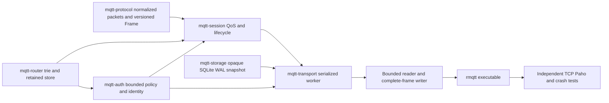

# Architecture — revision6 / Phase2e

TCP MQTT3.1.1 and an initial MQTT5 subset, QoS0/1/2, Retained and Last Will are
implemented using one bounded SessionEngine/outbox pipeline in both volatile and
SQLite modes. MQTT311 non-clean sessions require --storage-path; MQTT5 positive
expiry also works across disconnects in volatile memory. TLS and WebSocket remain unsupported. Authentication/ACL uses a bounded local
policy with pluggable hooks, sharing the transactional session model. Full MQTT conformance
and production-readiness are not claimed.

## Modules and dependency graph

lib.rs contains docs/module declarations/reexports only. Protocol splits packet,
codec,error; Router has filter,trie,retained; Session has error,identifiers,incoming,
outgoing,durable plus records/legacy,lifecycle,retention,authorization,mqtt5,expiry helpers;
Auth has api,policy,containment,error; Storage has
model,error,trait,memory,durable; Transport has config,server,packet_io,durable and the production durable/network module.
The previous duplicate live state/connection production path was retired; its
meaningful regressions now exercise the shared runtime.

Each writer specialist uses an isolated Git worktree/branch. Coordinator owns
contracts, CLI, architecture/progress and final cherry-pick integration. Current
phase2e contract supersedes changed wire/session/flow/expiry/schema boundaries; prior contracts
and progress preserve history. Public import paths stay stable except the additive
CONNECT credentials/Password, access_control config, identity/policy constructors
and PollOutcome documented in this phase.

## Serialized transaction and network lifecycle

Incremental decoding bounds full packet bytes. Fair readiness selection and a
bounded full-frame writer preserve control-read progress and frame integrity.
Commands use bounded mpsc(capacity=max_connections) to one spawn_blocking worker
owning SessionEngine, optional SqliteStore and online generation/notification maps.
No SQLite IO runs on async workers; no routing lock spans an await.

A mutation clones the engine, applies an event, retries eligible pending Wills,
validates/snapshots, commits SQLite if enabled, installs the proposal and only then
exposes ACKs/outgoing packets. Failure discards the complete proposal; SQL failure
cancels service rather than falling back to memory success. Empty unchanged polls
neither commit nor notify. Even Poll(None) commits/notifies if Will retry or authorization pruning progressed.

| Event | Atomic effects before response/transmission |
| --- | --- |
| CONNECT | Authentication and ownership/Will authorization, then session create/resume/reset, old connection Will if takeover, new Will registration |
| SUBSCRIBE | Subscription grants and retained replay queued before SUBACK |
| Incoming QoS1 | Retained update/delete if flagged plus all accepted recipient outboxes before PUBACK |
| Incoming QoS2 PUBLISH | Pending original wire packet before PUBREC |
| PUBREL | Incoming removal, retained update/delete and all recipient outboxes before PUBCOMP |
| Outgoing first PUBLISH | Queue removal and allocated ID/stage before transmission |
| PUBREC | AwaitComp before PUBREL; repeat PUBREC repeats PUBREL |
| PUBACK/PUBCOMP | Final removal/ID release before later allocation |
| Normal DISCONNECT | Active Will cancellation/session end before closing |
| Unexpected end | Session end plus Will fanout/retained update, or preserved pending intent |

Incoming/outgoing ID namespaces are independent. Existing QoS primitives/allocator
are reused. Reconnect replays unresolved PUBLISH with original ID, DUP=true and
original send order; AwaitComp replays only PUBREL. Source DUP is never a business
message deduplication key. Incoming repeated/unknown PUBREL never re-routes.

Every handle/poll/end checks network generation. Takeover replaces/cancels the old
registration only after the old-Will/new-session transaction succeeds. Stale cleanup
cannot affect the replacement. Reader submits a graceful worker end on DISCONNECT
and clears identity after success, preventing a second unexpected cleanup. EOF,
RST, writer/protocol error, Keep Alive timeout and server shutdown use unexpected
end. Writer is aborted on close; only an actually queued pre-CONNECT refusal
CONNACK flushes. Successful outgoing ACK invalidates obsolete local replay frames.

## Retained and Will semantics

RetainedStore is global, bounded by count and logical topic/payload bytes, and reuses
existing topic/filter/$SYS matching. Empty payload deletes, nonempty replaces exact
topic. RETAIN=0 never changes stored state. Session reset/disconnect never deletes
global retained messages. Established live/outbox forwarding uses retain=false.
An accepted new or identical replacement subscription replays retain=true with
QoS=min(stored,grant). Filters within SUBSCRIBE are processed sequentially, so each
matching filter may replay a copy; ordinary live routing deduplicates using maximum
matching subscription QoS. Full replay aborts the proposed event without success ACK.
Retained replay retain flags survive queued/outgoing persistence and DUP retransmit.

CONNECT Will is a binary payload with QoS0/1/2 and optional retain, bound to the
accepted network connection. Its publication/removal shares the existing outbox
transaction. The old Will publishes on takeover before replacement registration.
Normal DISCONNECT suppresses it. A closing clean source is removed before fanout;
a persistent source is offline and may queue its own QoS>0 Will. Retained Wills use
the same replace/delete rule; active registration alone does not alter retained state.

Capacity failure never drops or partially publishes a Will. A bounded pending
record retries after progress. A same-ID CONNECT carrying a new Will is refused
while the older pending intent cannot drain; a no-new-Will reconnect can resume and
drain its own full outbox while preserving that older record. Normal/abnormal end
of that no-Will connection cannot erase or duplicate the older intent. Active or
pending definitions are persisted even for clean-session origins with SQLite.
Startup marks loaded active Wills pending, tries publication and commits before
serving clients; remaining capacity-blocked intents stay recorded. Volatile process
death loses all memory state; SQLite process recovery defers Wills until restart.

## Snapshot, ownership and quotas

SQLite WAL/FULL and singleton opaque container schema remain version1, protected
by the existing permanent canonical `.broker-lock` OS advisory lock. Business JSON
is now schema4: persistent sessions plus required global retained and wills arrays.
Each session/Will has a required stable owner identity; passwords/hashes/raw CONNECT are never stored.
Static owner labels include the non-secret username. Schema3 owners are preserved;
1/2 migrate to anonymous. Schema4 adds required message/Will/retained properties,
per-ID incoming/outgoing metadata, and session_expiry_interval/expires_at fields.
Queued Message adds retain. Will records are client_id,owner,pending,will(topic,payload,
qos,retain); retained records are topic,payload,qos and never empty. Valid schema1
is explicitly decoded with its old DTOs and migrated to empty globals/retain=false;
old retained wire that schema1 could not store is rejected. Schema2 preserves its
required globals; versions1/2 migrate to anonymous,3 preserves identity. Schema4 strictly
validates fields, uniqueness, packet IDs/stages/order/topics and restored quotas.
All restored sessions start offline; online maps/generations/replay cursors are
runtime-only. Unknown/corrupt records fail startup rather than resetting state.

CLI/BrokerConfig bound connections, sessions, Will count, retained topics, queues,
subscriptions, inflight, packet bytes, serialized live/snapshot bytes and IO timers.
Whole-state limits include clean sessions and global data. Count/byte limits are
not an aggregate process-memory/disk budget; bitmap/clone/JSON/staging copies remain
bounded additional costs. Per-proposal Router rebuilding and per-pending-Will
clones are correctness-first choices with unmeasured costs. Worker/storage waits
can delay controls; broad stress/latency/performance work remains open.

SQLite checks BLOB length before allocation and rejects foreign/container schemas.
Sidecar ownership excludes cooperating concurrent brokers; existing symlinks share
the canonical lock, dangling links are refused. Hard-link aliases/external active
DB renaming/replacement/modification are unsupported. Physical power-loss behavior
and application-side exactly-once processing are not claimed by process SIGKILL or
SQLite page-quota SQLITE_FULL tests.

## Verification and history

Actual commands/results and provenance are in progress.md; remaining dependencies
are in tasks.md. Independent tests use ACKs/PING or confirmed recipient output as
commit barriers. They cover both modes, Will normal/abnormal/timeout/takeover,
retained update/delete/replay, transaction rollback, restart and real schema1 DB
migration. lib.rs declaration-only policy and strict Rustdoc are checked.

Normative references: OASIS MQTT3.1.1 sections3.1.2.5–7,3.3.1.3,3.8.4
(https://docs.oasis-open.org/mqtt/mqtt/v3.1.1/os/mqtt-v3.1.1-os.html);
SQLite WAL/FULL (https://www.sqlite.org/wal.html,
https://www.sqlite.org/pragma.html#pragma_synchronous).

Revisions1/2 delivered QoS0 then live QoS1/2. Revision3 added persistent sessions,
SQLite atomic outboxes/recovery, followed by thin-library structural refactoring.
Revision4 adds global Retained and connection Will using the same persistence path,
explicit schema1->2 migration and shared volatile/durable runtime.

## Revision5: authenticated transaction boundaries

The coordinator freezes docs/contracts/phase2d.md before isolated Auth, Protocol and
Session work, followed by independent Quality and Transport integration. CLI parses
--auth-policy without IO, then loads at most MAX_POLICY_BYTES+1 on spawn_blocking
before binding. StaticPolicy is immutable per run, default-deny and contains bounded
Argon2id PHC work factors. No policy uses AllowAnonymous for compatibility.

The blocking worker authenticates before copying/mutating model state. Typed failures
map to CONNACK4/5 with bounded flush; rejected CONNECT never processes pipelined data,
registers Will, cancels the old generation or resets its session. Model then checks
owner and new Will permission before takeover. Same-owner normal takeover semantics
remain. Separate identity labels prevent user:anonymous colliding with anonymous.

SessionEngine checks Publish before staging/ACK, including original inbound QoS2
topic on PUBREL. Filter admission uses safe conservative containment rather than
matching a filter as a topic. Receive checks cover live/offline routing, retained
replay and retransmission. Startup reconciles revoked records, recovers authorized
Wills and commits schema3 before ready. Pruning frees IDs/cursors together and
PollOutcome.changed forces commits even with no output. AwaitComp may finish its
already accepted control exchange; incoming pending state remains for reauthorization.

Revoked Wills are explicitly suppressed/removed; retained globals remain protected
by recipient rights. Anonymous legacy ownership is never silently reassigned to an
authenticated claimant. Removing/offline converting legacy owners is not implemented.
Policy reload, remote providers, TLS, per-identity rate limits and timing-attack
resistance guarantees remain outside this implementation. Argon2 and full-state
authorization reconciliation add bounded but unbenchmarked blocking-worker cost.

Normative credential/denial reference: OASIS MQTT3.1.1 sections3.1.2.8–9,3.1.3.4–5,
3.2.2.3,3.3.5 and3.8.4
(https://docs.oasis-open.org/mqtt/mqtt/v3.1.1/os/mqtt-v3.1.1-os.html).
Hash API reference: https://docs.rs/argon2/0.5.3/argon2/.

## Revision6: versioned wire, deadlines and connection quotas

Protocol keeps legacy Packet/Will/encode/decode and adds Frame, Properties, ReasonCode,
ProtocolVersion and incremental versioned codecs. Transport negotiates once; partial
peek_connect_version is only for correctly framing a failed CONNECT. Property
context/value errors have typed classifications, including malformed0x81, protocol0x82
and specified codes such as zero TopicAlias0x94. AuthenticationData Debug is redacted.

SessionEngine's Clock is injected for deterministic expiry tests. Clean Start resets
old state independently of session expiry; wrappers map MQTT311 clean flags to0 or
UINT_MAX. Known offline deadlines are persisted; loaded active finite records start
a conservative restart-time deadline. Tick requests are bounded; workers cheaply
skip cloning/commit when no expiry is due. Expiry, ACL pruning, pending Will retry
and outbox changes use the existing proposal/commit/install boundary.

ReceiveMaximum and runtime protocol version are connection properties, not session
records. Per-connection sent IDs reserve QoS1/2 credit; positive PUBREC does not
release it. Reconnect can replay fewer messages than the persisted pending count,
while PUBREL/control bypasses a blocked replay head. Negative ACK releases matching
stage, ID, metadata and quota without retry. Inbound network credits last until the
relevant ACK is actually written, with QoS and generation tickets preventing stale
completion callbacks from releasing a reused ID.

Application metadata stays alongside canonical MQTT311 QoS wire bytes; all pending
state machines/routing remain shared. Retained metadata uses a model sidecar paired
with the existing store, not a competing router. Properties survive QoS2 original
ownership, replay, offline/retained/Will recovery and are stripped only for311 wire.
Durable incoming entries are(id,canonical_bytes,properties) triples; outgoing records
add properties to existing stage, queued/retained/WillData add properties. Legacy
1/2/3 DTOs explicitly migrate to empty metadata and infinite expiry; current4 fields
are required. Runtime sent sets/quota/version are omitted from persistence.

Terminal DISCONNECT uses a bounded priority signal: finish at most the in-progress
frame, discard queued data, then write the terminal frame; timeout closes the socket.
Never cancel a partial frame then append another one on the same stream. At most
two frame deadlines bound terminal shutdown. Successful takeover sends old V5 socket
reason0x8E when writable; stale cleanup cannot affect the new generation.

Supported/excluded property semantics and initial refusal reasons are enumerated
in phase2e.md/README. Codec coverage of all property types does not mean runtime
implementation of every optional feature. Topic aliases, subscription IDs/shared
subscriptions, nondefault subscription options, MessageExpiry/WillDelay, enhanced
AUTH, client MaximumPacketSize and assigned Client IDs remain explicit exclusions.
No MQTT5 full-conformance, performance or production claim is made.

MQTT5 normative source: https://docs.oasis-open.org/mqtt/mqtt/v5.0/os/mqtt-v5.0-os.html.
