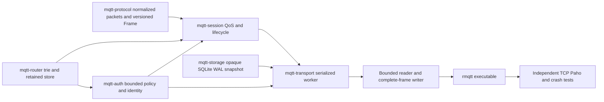

# Architecture — revision17 / Phase3 baseline

TCP MQTT3.1.1 and the recorded MQTT5 server scope, QoS0/1/2, Retained and Last Will are
implemented using one bounded SessionEngine/outbox pipeline in both volatile and
SQLite modes. MQTT311 non-clean sessions require --storage-path; MQTT5 positive
expiry also works across disconnects in volatile memory. TLS and WebSocket remain unsupported. Authentication/ACL uses a bounded local
policy with pluggable hooks, sharing the transactional session model. Full MQTT conformance
and production-readiness are not claimed.

## Modules and dependency graph

lib.rs contains docs/module declarations/reexports only. Protocol splits packet,
codec,error; Router has filter,trie,retained; Session has error,identifiers,incoming,
outgoing,durable plus records/legacy,lifecycle,retention,authorization,mqtt5,expiry,temporal,subscriptions helpers;
Auth has api,policy,containment,error; Storage has
model,error,trait,memory,durable; Transport has config,server,packet_io,durable and production durable/network/aliases modules.
The previous duplicate live state/connection production path was retired; its
meaningful regressions now exercise the shared runtime.

Each writer specialist uses an isolated Git worktree/branch. Coordinator owns
contracts, CLI, architecture/progress and final cherry-pick integration. Current
phase2o contract supersedes changed wire/session/flow/expiry/schema boundaries; prior contracts
and progress preserve history. Public import paths stay stable except the additive
CONNECT credentials/Password, access_control config, identity/policy constructors
PollOutcome, stamped-ingress and Delivery preparation/begin APIs documented in the
current contracts.

## Serialized transaction and network lifecycle

Incremental decoding bounds full packet bytes. Fair readiness selection and a
bounded full-frame writer preserve control-read progress and frame integrity.
Commands use bounded mpsc(capacity=max_connections) to one spawn_blocking worker
owning SessionEngine, optional SqliteStore and online generation/notification maps.
No SQLite IO runs on async workers; no routing lock spans an await.

A mutation clones the engine, applies an event, retries eligible pending Wills,
validates/snapshots, commits SQLite if enabled, installs the proposal and only then
exposes ACKs/outgoing packets. Failure discards the complete proposal; SQL failure
cancels service rather than falling back to memory success. Empty unchanged polls
neither commit nor notify. Even Poll(None) commits/notifies if Will retry or authorization pruning progressed.

| Event | Atomic effects before response/transmission |
| --- | --- |
| CONNECT | Authentication and ownership/Will authorization, then session create/resume/reset, old connection Will if takeover, new Will registration |
| SUBSCRIBE | Subscription grants and retained replay queued before SUBACK |
| Incoming QoS1 | Retained update/delete if flagged plus all accepted recipient outboxes before PUBACK |
| Incoming QoS2 PUBLISH | Pending original wire packet before PUBREC |
| PUBREL | Incoming removal, retained update/delete and all recipient outboxes before PUBCOMP |
| Outgoing first PUBLISH | Queue removal and allocated ID/stage before transmission |
| PUBREC | AwaitComp before PUBREL; repeat PUBREC repeats PUBREL |
| PUBACK/PUBCOMP | Final removal/ID release before later allocation |
| Normal DISCONNECT | Active Will cancellation/session end before closing |
| Unexpected end | Session end plus Will fanout/retained update, or preserved pending intent |

Incoming/outgoing ID namespaces are independent. Existing QoS primitives/allocator
are reused. Reconnect replays unresolved PUBLISH with original ID, DUP=true and
original send order; AwaitComp replays only PUBREL. Source DUP is never a business
message deduplication key. Incoming repeated/unknown PUBREL never re-routes.

Every handle/poll/end checks network generation. Takeover replaces/cancels the old
registration only after the old-Will/new-session transaction succeeds. Stale cleanup
cannot affect the replacement. Reader submits a graceful worker end on DISCONNECT
and clears identity after success, preventing a second unexpected cleanup. EOF,
RST, writer/protocol error, Keep Alive timeout and server shutdown use unexpected
end. Writer is aborted on close; only an actually queued pre-CONNECT refusal
CONNACK flushes. Successful outgoing ACK invalidates obsolete local replay frames.

## Retained and Will semantics

RetainedStore is global, bounded by count and logical topic/payload bytes, and reuses
existing topic/filter/$SYS matching. Empty payload deletes, nonempty replaces exact
topic. RETAIN=0 never changes stored state. Session reset/disconnect never deletes
global retained messages. Established live/outbox forwarding uses retain=false.
An accepted new or identical replacement subscription replays retain=true with
QoS=min(stored,grant). Filters within SUBSCRIBE are processed sequentially, so each
matching filter may replay a copy; ordinary live routing deduplicates using maximum
matching subscription QoS. Full replay aborts the proposed event without success ACK.
Retained replay retain flags survive queued/outgoing persistence and DUP retransmit.

CONNECT Will is a binary payload with QoS0/1/2 and optional retain, bound to the
accepted network connection. Its publication/removal shares the existing outbox
transaction. The old Will publishes on takeover before replacement registration.
Normal DISCONNECT suppresses it. A closing clean source is removed before fanout;
a persistent source is offline and may queue its own QoS>0 Will. Retained Wills use
the same replace/delete rule; active registration alone does not alter retained state.

Capacity failure never drops or partially publishes a Will. A bounded pending
record retries after progress. A same-ID CONNECT carrying a new Will is refused
while the older pending intent cannot drain; a no-new-Will reconnect can resume and
drain its own full outbox while preserving that older record. Normal/abnormal end
of that no-Will connection cannot erase or duplicate the older intent. Active or
pending definitions are persisted even for clean-session origins with SQLite.
Startup marks loaded active Wills pending, tries publication and commits before
serving clients; remaining capacity-blocked intents stay recorded. Volatile process
death loses all memory state; SQLite process recovery defers Wills until restart.

## Snapshot, ownership and quotas

SQLite WAL/FULL and singleton opaque container schema remain version1, protected
by the existing permanent canonical `.broker-lock` OS advisory lock. Business JSON
is now schema7: persistent sessions plus required global retained and wills arrays.
Each session/Will has a required stable owner identity; passwords/hashes/raw CONNECT are never stored.
Static owner labels include the non-secret username. Schema3 owners are preserved;
1/2 migrate to anonymous. Schema4 adds required message/Will/retained properties,
per-ID incoming/outgoing metadata, and session_expiry_interval/expires_at fields.
Schema5 adds required message deadlines, outgoing started flags, Will delay/due
fields and envelope clock_floor; version4 migrates with absent message deadlines,
conservatively started outgoing exchanges and delay0 Wills. Required fields cannot
be omitted; all versions1..4 migrate explicitly without resetting IDs or owners.
Schema6 adds full subscription records and required queue/outgoing retained_replay
markers, migrating version5 explicitly. Schema7 adds required nullable queued/outgoing
shared group markers, migrating strict version6 explicitly. Queued Message adds retain. Will records are client_id,owner,pending,delay_interval,
due_at,will(topic,payload,
qos,retain); retained records are topic,payload,qos and never empty. Valid schema1
is explicitly decoded with its old DTOs and migrated to empty globals/retain=false;
old retained wire that schema1 could not store is rejected. Schema2 preserves its
required globals; versions1/2 migrate to anonymous,3 preserves identity. Schema6 strictly
validates fields, uniqueness, packet IDs/stages/order/topics and restored quotas.
All restored sessions start offline; online maps/generations/replay cursors are
runtime-only. Unknown/corrupt records fail startup rather than resetting state.

CLI/BrokerConfig bound connections, sessions, Will count, retained topics, queues,
subscriptions, inflight, packet bytes, serialized live/snapshot bytes and IO timers.
Whole-state limits include clean sessions and global data. Count/byte limits are
not an aggregate process-memory/disk budget; bitmap/clone/JSON/staging copies remain
bounded additional costs. Per-proposal Router rebuilding and per-pending-Will
clones are correctness-first choices with unmeasured costs. Worker/storage waits
can delay controls; broad stress/latency/performance work remains open.

SQLite checks BLOB length before allocation and rejects foreign/container schemas.
Sidecar ownership excludes cooperating concurrent brokers; existing symlinks share
the canonical lock, dangling links are refused. Hard-link aliases/external active
DB renaming/replacement/modification are unsupported. Physical power-loss behavior
and application-side exactly-once processing are not claimed by process SIGKILL or
SQLite page-quota SQLITE_FULL tests.

## Verification and history

Actual commands/results and provenance are in progress.md; remaining dependencies
are in tasks.md. Independent tests use ACKs/PING or confirmed recipient output as
commit barriers. They cover both modes, Will normal/abnormal/timeout/takeover,
retained update/delete/replay, transaction rollback, restart and real schema1 DB
migration. lib.rs declaration-only policy and strict Rustdoc are checked.

Normative references: OASIS MQTT3.1.1 sections3.1.2.5–7,3.3.1.3,3.8.4
(https://docs.oasis-open.org/mqtt/mqtt/v3.1.1/os/mqtt-v3.1.1-os.html);
SQLite WAL/FULL (https://www.sqlite.org/wal.html,
https://www.sqlite.org/pragma.html#pragma_synchronous).

Revisions1/2 delivered QoS0 then live QoS1/2. Revision3 added persistent sessions,
SQLite atomic outboxes/recovery, followed by thin-library structural refactoring.
Revision4 adds global Retained and connection Will using the same persistence path,
explicit schema1->2 migration and shared volatile/durable runtime.

## Revision5: authenticated transaction boundaries

The coordinator freezes docs/contracts/phase2d.md before isolated Auth, Protocol and
Session work, followed by independent Quality and Transport integration. CLI parses
--auth-policy without IO, then loads at most MAX_POLICY_BYTES+1 on spawn_blocking
before binding. StaticPolicy is immutable per run, default-deny and contains bounded
Argon2id PHC work factors. No policy uses AllowAnonymous for compatibility.

The blocking worker authenticates before copying/mutating model state. Typed failures
map to CONNACK4/5 with bounded flush; rejected CONNECT never processes pipelined data,
registers Will, cancels the old generation or resets its session. Model then checks
owner and new Will permission before takeover. Same-owner normal takeover semantics
remain. Separate identity labels prevent user:anonymous colliding with anonymous.

SessionEngine checks Publish before staging/ACK, including original inbound QoS2
topic on PUBREL. Filter admission uses safe conservative containment rather than
matching a filter as a topic. Receive checks cover live/offline routing, retained
replay and retransmission. Startup reconciles revoked records, recovers authorized
Wills and commits schema3 before ready. Pruning frees IDs/cursors together and
PollOutcome.changed forces commits even with no output. AwaitComp may finish its
already accepted control exchange; incoming pending state remains for reauthorization.

Revoked Wills are explicitly suppressed/removed; retained globals remain protected
by recipient rights. Anonymous legacy ownership is never silently reassigned to an
authenticated claimant. Removing/offline converting legacy owners is not implemented.
Policy reload, remote providers, TLS, per-identity rate limits and timing-attack
resistance guarantees remain outside this implementation. Argon2 and full-state
authorization reconciliation add bounded but unbenchmarked blocking-worker cost.

Normative credential/denial reference: OASIS MQTT3.1.1 sections3.1.2.8–9,3.1.3.4–5,
3.2.2.3,3.3.5 and3.8.4
(https://docs.oasis-open.org/mqtt/mqtt/v3.1.1/os/mqtt-v3.1.1-os.html).
Hash API reference: https://docs.rs/argon2/0.5.3/argon2/.

## Revision6: versioned wire, deadlines and connection quotas

Protocol keeps legacy Packet/Will/encode/decode and adds Frame, Properties, ReasonCode,
ProtocolVersion and incremental versioned codecs. Transport negotiates once; partial
peek_connect_version is only for correctly framing a failed CONNECT. Property
context/value errors have typed classifications, including malformed0x81, protocol0x82
and specified codes such as zero TopicAlias0x94. AuthenticationData Debug is redacted.

SessionEngine's Clock is injected for deterministic expiry tests. Clean Start resets
old state independently of session expiry; wrappers map MQTT311 clean flags to0 or
UINT_MAX. Known offline deadlines are persisted; loaded active finite records start
a conservative restart-time deadline. Tick requests are bounded; workers cheaply
skip cloning/commit when no expiry is due. Expiry, ACL pruning, pending Will retry
and outbox changes use the existing proposal/commit/install boundary.

ReceiveMaximum and runtime protocol version are connection properties, not session
records. Per-connection sent IDs reserve QoS1/2 credit; positive PUBREC does not
release it. Reconnect can replay fewer messages than the persisted pending count,
while PUBREL/control bypasses a blocked replay head. Negative ACK releases matching
stage, ID, metadata and quota without retry. Inbound network credits last until the
relevant ACK is actually written, with QoS and generation tickets preventing stale
completion callbacks from releasing a reused ID.

Application metadata stays alongside canonical MQTT311 QoS wire bytes; all pending
state machines/routing remain shared. Retained metadata uses a model sidecar paired
with the existing store, not a competing router. Properties survive QoS2 original
ownership, replay, offline/retained/Will recovery and are stripped only for311 wire.
Durable incoming entries are(id,canonical_bytes,properties,expires_at) tuples; outgoing
records add properties, expires_at and started to their stage. Queued/retained data
also carry deadlines; WillData holds relative TTL until publication. Legacy1/2/3
DTOs migrate to empty metadata; version4 preserves existing metadata and session
deadlines. Schema5 time fields are required. Runtime sent sets/quota/version are omitted from persistence.

Terminal DISCONNECT uses a bounded priority signal: finish at most the in-progress
frame, discard queued data, then write the terminal frame; timeout closes the socket.
Never cancel a partial frame then append another one on the same stream. At most
two frame deadlines bound terminal shutdown. Successful takeover sends old V5 socket
reason0x8E when writable; stale cleanup cannot affect the new generation.

Current supported/excluded property semantics are enumerated in phase2i.md/README;
phase2e.md preserves initial refusal history. Codec coverage of all property types
does not mean runtime implementation of every optional feature. Shared subscriptions and enhanced AUTH were exclusions at Phase2e; Phase2j below adds them.
No MQTT5 full-conformance, performance or production claim is made.

MQTT5 normative source: https://docs.oasis-open.org/mqtt/mqtt/v5.0/os/mqtt-v5.0-os.html.

## Phase2f temporal and first-write boundaries

The frozen [Phase2f contract](contracts/phase2f.md) supersedes prior exclusions of
MessageExpiry/WillDelay. The model reuses Clock and the existing QoS FSMs/outboxes;
absolute message deadlines are shared across offline, retained and mixed-version
copies. TTL0 is immediate and UINT_MAX finite. Incoming QoS2 retains its protocol
stage after expiry; expired retained replacement removes the former value.

Reader timestamps include completed-buffer and actor-queue waiting. Raw receive age
is rebased onto effective logical time; restored clock_floor prevents moving back
below committed observations. Pure clock observation neither creates semantic
progress nor repeatedly notifies connections. The aggregate timer includes queued,
retained, unstarted outgoing, offline session and unattempted Will deadlines.
Capacity-blocked Will timer state is runtime-only, reset on recovery, and retries
on actual progress without a due-deadline spin.

Poll reserves a Delivery/ticket; Begin validates generation and expiry and commits
started=true before output. A stale/expired unstarted ticket returns no frame and
retires ID/order/quota metadata atomically. Started QoS1/2 exchanges remain until
protocol completion, including TTL0 replay; PUBREC advances to PUBREL-only state.
The writer refreshes remaining TTL after SQL, then writes a complete frame with
existing bounded queues/terminal priority. Snapshot cloning and this additional
start transaction have no measured performance baseline. SQL and TCP cannot commit
atomically: persisted start intent conservatively means may-have-sent. A later
wire-only clock observation is not persisted until another model transaction, so
crash plus clock rollback may exceed that last advertised TTL, but not the ceiling
from committed observations. This is logical rollback protection, not certification
of physical wall-clock accuracy.

Will scheduling uses min(disconnect+delay,session-expiry). Only reason00 cancels;
04/80 and other valid nonzero reasons schedule. A surviving pre-due session resume
cancels delayed intent; expiry0, CleanStart or elapsed deadline forces publication.
Ended old sessions/subscriptions are removed before forced-Will fanout, avoiding
phantom self-queue backpressure. Real external capacity pressure still defers intent.
Will TTL begins at successful publication. Known due times persist; active-at-crash
connections conservatively start delay at restart, capped by restored session end.
Startup validation, expiry, ACL reconciliation and Will recovery commit before ready.

At Phase2g, shared subscriptions and enhanced AUTH remained unsupported; Phase2h below adds nondefault options and subscription identifiers, and Phase2j adds shared groups and opt-in PLAIN. TLS/WebSocket/cluster and full conformance remain future work.

## Phase2g connection limits and resolved session keys

The [Phase2g contract](contracts/phase2g.md) supersedes prior refusal of client
MaximumPacketSize and empty V5 IDs. No persistent schema changes are required.
ConnectionOptions adds maximum_packet_size; restored sessions default to the
protocol maximum and each CONNECT resets this runtime-only field. Server allocation/
input/output resource limits remain separate from a peer's negotiated inbound cap.

Online admission skips oversized candidates and prunes guaranteed-oversize backlog
before queue limits, including retained replay; offline admission ignores old peer caps.
Poll transactionally drops oversized queued/replayed PUBLISH copies as completed,
retiring all QoS IDs/order/expiry/tickets/quota, including previously started payloads.
Begin checks the final encoded frame too. This explicit packet-size discard rule is
separate from Message Expiry's obligation to finish started exchanges. Released
QoS2 stages remain PUBREL-only. Routing does not reject a publication merely because
one peer has a small cap; global retained state survives per-recipient discard.
Existing global server resource/version-growth admission constraints remain intact.

The worker resolves empty V5 IDs using bounded OS-entropy allocation and checks
both session and Will keys before authentication/authorization. The resolved key
is used for records, registration, cleanup and replies; no empty network identity
is retained. The exact successful CONNACK, including mandatory capability/assignment
properties, must fit before mutating the proposal or old connection. Durable commit
precedes successful response, preserving the existing SQL/TCP uncertainty boundary.
Assignment is not an authentication credential; normal owner/ACL rules still apply.

Writer length guards apply to data, control, refusal and terminal frames. Oversized
mandatory controls close without truncation or partial output. A protocol-owned
prefix helper reuses the canonical property parser to discover a trustworthy cap
before reporting errors in a later CONNECT payload, bounded by declared packet
length even with coalesced input. Unknown/invalid property blocks establish no cap.
Peer-cap scans, encoded-size preflight and entropy allocation are bounded but have
no measured performance baseline. Row-level persistence, packet-size indexes and
higher throughput require measurement; no new compatibility/performance claim.

## Phase2h per-filter state and recipient metadata

The [Phase2h contract](contracts/phase2h.md) supersedes refusal of valid subscription
options/identifiers. Router exposes exact indexed matching filter tuples, preserving
distinct overlapping subscriptions while existing max-QoS APIs remain unchanged.
Protocol option/property validation is reused. Transport advertises identifier
availability1 explicitly, retaining the prior17/43byte success CONNACK boundaries.

Schema6 full subscription records hold filter, QoS, NL, RAP, RH and required nullable
identifier. Legacy1..5 explicitly migrate defaults without reconstructing unknown
metadata; strict old DTOs reject smuggled new identifier state. Queue and outgoing
records require retained_replay with matching runtime per-ID lifetime. This marker
distinguishes a live RAP1 message from retained subscription replay on V5↔311
resume:311 live output has RETAIN0; subscription replay retains1. Existing owners,
time floors, deadlines, QoS stages, order/IDs, application metadata and Wills survive.

Live source ClientID comes from normal publisher/session QoS2 completion or Will
record, not a new storage service. ACL/NL filtering precedes highest-QoS, identifier
and RAP aggregation. A single deduplicated live copy uses any-eligible-RAP retain
policy; identifiers include each eligible matching subscription with multiplicity.
Retained replay follows RH/sequential filter replacement and carries only the
triggering entry's identifier. No Local does not suppress subscription-triggered
retained replay, consistent with established Mosquitto retained replay behavior.

Recipient metadata is captured before queue admission, including full identifier
varint costs. Existing negotiated-cap pruning/global resource policy/atomic outbox
commit apply. Incoming/global retained/Will properties cannot carry subscription
IDs; trusted queued/outgoing delivery metadata can. Retries preserve captured
metadata even after replacement/unsubscribe; PUBREC still retires payload metadata
and transitions to PUBREL only. Additional record/index/clone/encoding costs have
not been benchmarked. Remaining optional semantics and hardening are in tasks.md.

## Phase2i network-local Topic Alias boundary

The [frozen contract](contracts/phase2i.md) adds separate bounded reader/writer maps
without changing canonical SessionEngine APIs or schema6. BrokerConfig adds
u16 topic_alias_maximum default32, CLI0..65535. Successful CONNACK always advertises
this exact value, including0; default complete success is20bytes or46 with assigned
ID. Exact preflight still precedes session/Will/takeover mutation.

The reader resolves full-topic binds/empty references after bounded wire decoding,
strips alias properties and checks normalized canonical resource size before worker
submission. Original read timestamp/flags/IDs/properties remain intact. Canonical
expansion exhaustion is97, original oversized wire is95, invalid range/reference94.
QoS2 originals are stored under their resolved Topic and cannot be changed by later
wire rebindings or duplicate payloads. ACL/NL and routing always see canonical names.

The writer owns outbound state, budgeted by min(clientMaximum,localMaximum).
After transactional Begin, TTL refresh and terminal-priority check it prepares the
exact next wire frame. Binding/replacement commits only after write_all succeeds;
references cannot overtake bindings. Candidate encoding includes all variable-int
widths and final min(server,peer) guard. Failed alias inflation falls back without
installing a mapping; known references are used only if smaller and fitting.

Maps are sparse/count-bounded and reset with each network connection, independently
of SessionPresent/clean flags. No aliases/limits are stored in snapshot or outbox.
Canonical admission/discard policy is unchanged: compression does not salvage a
previously oversized canonical recipient. Additional map/string/encoding costs are
unmeasured and not included in the serialized model-byte budget. Paho2.1 receive
adapter usage is explicit in tests; raw wire checks remain independent evidence.

## Phase2j shared delivery and enhanced authentication

The [frozen contract](contracts/phase2j.md) separates group selection from session
ownership and connection authentication from durable session mutation. Shared and
Auth specialists implement their isolated modules in parallel; Transport consumes
those real APIs, and independent Quality tests exercise the integrated executable.

Shared subscription keys retain the full `$share/{name}/{filter}` string. The trie
indexes the underlying ordinary Topic Filter once; literal `$share/` Topics and ACL
grants are never recursively unwrapped. Each matching group independently chooses
one eligible member by runtime round-robin; ordinary subscriptions form a separate
copy. Online eligible members are preferred, QoS1/2 may queue to persistent offline
members, and recipient queue/packet limits include every planned copy. Shared
subscriptions do not trigger retained replay. Only the selected entry contributes
its QoS, RAP and Subscription Identifier.

Schema7 adds required nullable `shared_subscription` to queued/outgoing records,
with strict legacy1..6 migration. The marker follows existing session-owned outbox
transactions and QoS recovery. Last-member removal retires undelivered group copies;
already-started QoS obligations survive. A runtime group-incarnation token also
cancels a polled but unsent QoS0 lease, including destroy/recreate of the same group.
Cursors and incarnation epochs are bounded by live groups and are not persisted.
QoS2 remains owned by its selected session. This broker deliberately uses the same
ownership policy for QoS1: it does not redistribute an assigned copy after that
session ends, an explicit exception to the specification's SHOULD recommendation.
A group-owned redelivery spool remains future work.

Enhanced provider exchanges run on the existing serialized blocking worker. Pending
CONNECT state is generation-keyed and bounded, separate from SessionEngine. Initial
success preflights the exact CONNACK, authenticates the principal and commits the
existing session/Will/takeover transaction before registration or acceptance.
Abandoned initial exchanges create no session or Will. Connected reauthentication
keeps the existing owner and permits ordinary traffic under that owner while it is
pending; a successful exchange cannot change identity or reset aliases/QoS state.
Absolute deadlines, round and packet bounds apply independently of AUTH activity.
Consumed request secrets use the existing zeroizing Password wrapper and are absent
from durable records; Debug implementations redact authentication data.

The opt-in `--enhanced-auth-plain` mechanism implements real SASL PLAIN through the
existing credential verifier and ACLs, with direct or server-prompted credentials.
It adds no encryption and needs a protected transport; TLS is still unimplemented.
The default provider is disabled. SCRAM, delegated authzid, SASLprep normalization,
remote providers and auth rate/CPU isolation are not claimed implemented.

## Phase2k conformance evidence boundary

The clause catalogue and matrix in `docs/conformance/` separate implementation
availability from evidence for specific obligations. Coordinator pins source bytes,
records source-index anomalies and merges conservative review statuses. Reviewers
link exact source/test symbols and real commands; Quality checks inventory equality,
reference resolution and deterministic regeneration offline. These checks prevent
stale/fabricated links, not semantic overclaims; independent source review remains
required. Unnumbered candidates are heuristic, not an exhaustive normative extraction.

The frozen phase2k contract corrects three existing boundaries without a public API
or durable schema change: initial enhanced-auth failures use failed CONNACK before
acceptance; multiple UNSUBSCRIBE filters observe preceding removals; the codec
requires AuthenticationMethod on every AUTH while Transport checks its negotiated
value. Whole-request syntax validation precedes unsubscribe mutation, preserving
atomic rejection. Existing worker transactions, schema7, IDs, outbox, clock, alias
and authenticated-owner state remain the integration boundaries. Failure-first
regressions and independent TCP tests validate the corrections.

## Phase2l packet and property acceptance

The next acceptance group separates sender roles from symmetric wire validation.
Client allocator obligations are not certified by server allocator tests; server
identifier allocation/release/recovery and request-response identity each carry their
own evidence. Property tests use explicit independent ID/context fixtures, not the
production dispatch table as their oracle. Quality supplies actual TCP termination,
UTF-8 Topic equality, takeover and recovery probes in both storage modes.

No public API or schema change is implied by a missing test. Confirmed mismatches
must first receive a failure-first regression and frozen phase2l correction. Matrix
status changes are reconciled by the coordinator against exact new evidence; old
scope limitations cannot be hidden by a chapter-level pass assertion.

## Phase2m interpretive boundaries

The acceptance table now distinguishes packet-position syntax, endpoint direction,
branch-specific behavior and publisher-origin payload semantics. A stateless codec
can validate property positions and legal CONNACK values; that does not prove every
runtime reason mapping or origin's PFI1 data is correct. The immutable executable
still uses the existing session/outbox and schema7; only focused tests were added.

Wrong protocol names enter the Malformed path and already close silently. Unknown
levels use the pre-negotiation MQTT311 fallback; changing that fallback without
examining both specifications would regress a different conformance obligation.
Mixed ordinary RAP collapse and PFI sender-versus-forwarder interpretation remain
explicit rather than waived as MUST exceptions. Independent tests document current
policies without converting those interpretive gaps to verified rows.

## Phase2n resolved semantic boundaries

Frozen N1 selects per-subscription ordinary copies only for new retained live
publications with mixed eligible RAP values and a V5 recipient. Private ordinary
projection follows ACL/No Local eligibility; queue admission reserves every ordinary
copy before shared selection. Each split copy carries one subscription's QoS/flag/ID;
homogeneous/nonretained/311 and global retained replay keep existing semantics.
Schema7 and old accepted outbox metadata are preserved. This policy chooses the
specification's multiple-copy option without asserting it is the unique permitted
algorithm. Existing outbox/expiry/QoS/alias/ReceiveMaximum paths are reused.

Frozen N2 distinguishes producer PFI1 promises from optional receiver validation;
client-origin PUBLISH/Will bytes and PFI pass through unchanged. Published OS5.4.9
explicitly anticipates an unvalidating Server and validating Client. Codec framing
does not certify malformed producer bytes as well-formed data. Payload UTF8 is
RFC3629 data, not the stricter MQTT encoded-string rule. No broker-authored payload
feature is introduced.

Frozen N3 adds ProtocolMode Both/V311/V5 to runtime BrokerConfig and --protocol to
CLI. Gate rejection precedes worker Connect and state mutation; known prefix caps
constrain responses, unsupported layouts are never guessed. Both preserves its
legacy fallback while explicit V5 emits minimal84 and explicit V311 emits legacy1.
Config is not persisted; existing sessions can recover across endpoint profiles.
The matrix validates the explicit V5 profile's response rule and keeps Both's
compatibility boundary visible. Full server conformance remains a separate gate.

## Phase2o acceptance evidence boundaries

The frozen G1..G6 contract adds no runtime API or durable schema change. Protocol,
Transport and Quality writers used separate worktrees/branches; integration retained
existing session/outbox transactions. New tests close reason/context, reserved flag,
packet-direction, control-property isolation and generation/write-ticket evidence.
No confirmed runtime defect was found. lib.rs remains documentation/modules/exports.

Pinned HTML evidence is supplemented by authoritative DOCX paragraph/table review
and a separate endpoint role ledger. Offline guards bind G1 to exact reviewed IDs
and code/test symbols; U7 cannot pass with an open required gate. Source extraction
is a reproducible index, while semantic applicability remains explicit review.

Actual SQL locks, returned busy errors and process kills verify before/after-commit
recovery. Stable mutation and isolated nightly libFuzzer workspaces test codec and
bounded legacy/V5 recovery traces with controlled time. They introduce no production
nightly requirement. Network alias/provider AUTH/KeepAlive/concurrent scheduling are
validated separately from the pure model. This finite project acceptance does not
remove profile qualifications, SHOULD exceptions or hardware/power-loss limits.

## Phase3 measurement and resource boundaries

Phase3 freezes local benchmark/reliability acceptance without a runtime API or schema
change. Load driver, transport tests and TCP/CI tests were implemented in three
independent Git worktrees and integrated after review. All lib.rs files retain their
declaration/export structure. The production serialized-worker/outbox model is reused.

The baseline distinguishes ACK-only offered-load stress from completion-gated
routing: a QoS1 ingress ACK can precede all QoS0 fanout writes. Recipient queues may
fill under ACK-only load, and the existing policy atomically rejects the whole fanout
proposal with quota failure. This does not promise fairness to other recipients on
the same topic. Independent healthy-topic/control liveness is tested separately.
Completion-gated producers bound each publisher to one not-fully-received publication;
all waiting is included in timing. This is experimental client feedback, not a new
MQTT feature or evidence of a runtime optimization.

Current worker requests deep-clone the live engine and repeatedly validate serialized
state. Publishing rebuilds the ordinary routing index from registered subscriptions;
watch broadcasts may create empty delivery polls. Persistent commits replace the full
snapshot BLOB; memory mode also pays bounds/snapshot serialization. These static
paths are profiling candidates, not measured CPU percentages. QoS0 writes do not
have a third CompleteDelivery actor transaction. Changes to caching/notification/
copy-on-write/journaling must first preserve frozen authorization, expiry, atomic
admission and ACK/recovery contracts.

See docs/performance/ for actual per-run data, failed stress attempts, sampling
limits and reproduction. A local baseline does not establish saturation capacity,
long-duration reliability, a production SLA or hardware power-loss safety.

## Phase4: per-session actors

The [Phase4 contract](contracts/phase4.md) retires the single blocking worker. Each
client identifier is owned by one tokio actor holding a one-client SessionEngine
partition; connection tasks keep socket IO and forward requests to their actor.
Publications leave the partition as values: the publishing actor updates the shared
retained store, matches the incremental SubscriptionIndex and sends per-recipient
deliveries that each recipient commits independently. Client QoS1/2 acknowledgements
wait for recipient commits; a full recipient drops only its own copy. SQLite stores
one row per persistent partition and per retained topic (container2), written by a
group-committing storage thread; container1 snapshots migrate atomically at startup.

## Phase4b/4c: bounded hot paths and TLS

[Phase4b](contracts/phase4b.md) permits conservative upper bounds to avoid exact
Serde sizing when limits provably fit, and avoids subscription index updates for
transactions that cannot change filters. Proposals remain deep clones; persistent
row commit and per-recipient admission semantics are unchanged.

[Phase4c](contracts/phase4c-tls.md) adds one optional TLS listener using Rustls and
Tokio. TCP and TLS share MQTT framing, authentication, session actors, outbox and
cleanup. Plain TCP retains owned socket halves; TLS uses split encrypted IO with
explicit flush inside write deadlines. Connection permits cover TLS handshake,
which has its own deadline and shutdown cancellation before any MQTT state exists.
Identity files are bounded startup-only IO on the blocking pool. No durable schema
change, shared dual listeners, client certificate authentication or certificate
reload is introduced. Cluster work is deferred by user; the cluster document is a
proposal only.

## Phase4d: WS/WSS transport

[Phase4d](contracts/phase4d-websocket.md) adapts maintained RFC6455 WebSocket IO
to the same incremental MQTT byte stream. HTTP upgrade is bounded before parsing,
negotiates `mqtt`, and creates no client session before MQTT CONNECT. Binary WS
messages may contain multiple or partial MQTT packets; control traffic is handled
below MQTT and does not extend its Keep Alive. WS framing/write buffers have
independent finite limits. WSS composes the existing TLS identity and handshake.
Normal MQTT disconnect closes the transport without draining queued application
output; WS/TLS closure alone preserves ungraceful MQTT/Will semantics. State schema,
session ownership, admission and outbox remain unchanged; plaintext IO keeps the
existing owned socket halves. Each process still owns one listener/broker.

## Phase4e: authentication admission and mTLS

[Phase4e](contracts/phase4e-admission-mtls.md) adds broker-wide fixed-size token
admission plus separate bounded handshake/credential concurrency. Handshake slots
span transport negotiation through successful CONNACK flush; authentication slots
stay inside blocking jobs even after the caller is cancelled. Initial overload
never mutates session/takeover/Will; established MQTT traffic is not token-charged.
Cancellation cleanup is independent of authentication rate/CPU admission.

The existing immutable TLS identity optionally installs a mandatory WebPki client
certificate verifier using a bounded startup trust bundle. TLS/WSS share the same
trust policy; MQTT authentication and ACL remain independent. No certificate-name
principal mapping or schema change is introduced. Metrics, health, certificate
reload, shared multi-listener and performance acceptance remain outside this phase.

## Phase4f: read-only Dashboard

[The frozen Dashboard contract](contracts/phase4f-dashboard.md) adds an opt-in
loopback HTTP management plane beside the existing single MQTT listener. Its
management handle is attached to that exact broker instance. Views project only
committed session/subscription metadata and retained metadata; no durable export,
message payloads, credentials or alternate storage readers are exposed. Wire
PUBLISH/byte counters reset at process start and do not imply application delivery
or deduplication. Queries are bounded and eventually consistent across actors.

The React application is served from a bounded startup-loaded static bundle and
uses same-origin authenticated read-only APIs. The administrator token is separate
from MQTT credentials and kept in browser memory. Configuration is read-only;
resource metrics, event history and rule execution are explicitly unavailable.
The service is disabled unless both management CLI flags are present; remote access
requires a tunnel or a properly secured reverse proxy. No MQTT TLS/auth policy,
ACK/outbox transaction, durable schema or multiple-MQTT-listener change is implied.

The frontend foundation is Tailwind CSS v4 plus official shadcn/ui source controls,
with Lucide icons. Native dialog supplies detail-modal semantics without relaxing
CSP for runtime library style injection. Theme/base CSS is intentionally small;
layout and responsive behavior use utilities rather than a parallel custom UI kit.

Dashboard production assets are now compiled into rmqtt using include_dir without
filesystem metadata. Build.rs validates finite inputs and tracks dist changes; the
build host runs npm explicitly, not from Cargo. Default startup uses only embedded
assets and never searches cwd. Explicit --dashboard-dir replaces the entire bundle
through the same bounded/sensitive-file checks. Embedded records carry no runtime
filesystem identity; administrator credentials, TLS keys and state are not embedded.

## Phase5c: SQL rules and unified outbounds

The [unified outbound contract](contracts/phase5c-unified-outbounds.md) defines two
user-managed entities: Rules and Outbounds. A rule selects outbound_ids; each typed
outbound owns its destination configuration and delivery policy. No separate
connector/action workflow is exposed. Only Webhook is currently available.

A nonblocking publication observer prefilters topics and enqueues bounded events.
Four client-hashed SQL dispatcher threads preserve per-publisher processing order.
SQL plans are compiled at configuration time. Per-outbound queues, global16MiB
reservations, batching, retry pacing, lifecycle and statistics belong to mqtt-egress.
The scheduler talks to an object-safe async sink from mqtt-egress-core; protocol
success/retry classification, HTTP envelope/client/headers, TLS and redaction belong
to the mqtt-webhook adapter. New native sink types add typed config/factory/forms
without modifying SQL evaluation or scheduling. Unsupported types fail validation.

Configuration is enabled by default and persists in rmqtt-rules.sqlite. The bounded
SQLite singleton container is separate from the strict session database. New
schema_version2 records contain outbounds and rules. Recognized old SQLite blobs
are validated and converted transactionally: action IDs become outbound IDs,
referenced connector credentials become typed destination config and bindings are
preserved. No JSON file backend/import exists. Invalid migrations fail without
overwriting the prior record. Config commits precede snapshot publication; failures
stop dispatch until restart. DB IO runs on blocking workers, never MQTT hot paths.

Generation-owned sinks are cancelled/released on replacement; abandoned copies
count as drops. Source event_id and per-rule/outbound delivery_id remain stable
across retries. Webhook POST batches use outbound_id and are capped at1MiB including
envelope overhead. Credentials are redacted from API/debug output; preview has no
outbound side effects. MQTT/session control remains read-only with unchanged
Bearer/loopback/CSP policy. React assets remain embedded in the release binary.

Event queues/counters remain volatile best-effort. No durable action outbox,
Kafka/PostgreSQL/Redis, plugins, windowing or dead-letter replay is implemented.
This refactor adds no performance certification or change to MQTT ACK/outbox schema.

## Phase5d: Bounded outbound request concurrency

[Phase5d](contracts/phase5d-outbound-concurrency.md) adds optional
delivery.concurrency (default8,1..16) to the existing version2 policy. A single
collector forms batches, with bounded structured concurrent jobs per outbound.
Jobs retain byte reservations through global-permit waiting, attempts and backoff.
Each attempt holds a shared global permit (total16) and timeout; backoff releases
the permit, allowing unrelated jobs to progress. Cancellation/replacement/shutdown
cancel and join every child before owner cleanup. No mutex receiver across await,
unbounded per-event spawn or MQTT admission-path changes.

Actual-attempt RAII counters expose inflight_requests globally/per outbound.
Webhook jobs share a single sink Client whose idle-per-host capacity matches
concurrency; pool expiry remains30s. HTTP classification/body behavior is unchanged.
Concurrent arrival/completion order can vary; concurrency1 gives sequential batch
execution/retries. SQL enqueue order and MQTT delivery guarantees remain unchanged.
Old missing fields normalize8 without changing saved batching, IDs or secrets.

## Phase5e: Client-ordered outbound scheduling

[Phase5e](contracts/phase5e-client-ordered-outbounds.md) supersedes Phase5d's
unordered batch scheduler. Internal source-client metadata selects exact client
lanes per outbound/generation. One client batch owns its lane through attempts and
retry backoff; only terminal success/failure releases the next batch. Different
clients progress concurrently, with homogeneous-client batches. Backoff holds no
HTTP-attempt permit: configured concurrency now bounds attempts, not sleeping jobs.
Concurrency1 does not imply global FIFO across retrying clients.

Aggregate resident-event admission, byte reservations, bounded lane/task state and
idle-lane removal prevent moving backlog into an unbounded map. Source client ID
bytes count toward reservations. Cancel/replacement/shutdown/storage error release
all child jobs and local resources. Configuration/API/SQLite schemas, shared adapter
pools and MQTT ACK/session/outbox behavior remain unchanged. No durable delivery or
remote business-processing ordering guarantee is added.

## Phase5f: Generic durable outbound queue

[Phase5f](contracts/phase5f-durable-outbound-queue.md) adds mqtt-egress-log, a
synchronous segmented append journal with opaque bindings, source-client metadata
and delivery bytes. It has no Sink/HTTP/SQLite dependency. A bounded blocking actor
owns disk IO; the common outbound scheduler commits enqueue before invoking any
adapter and terminal completion before advancing a client. Payloads remain on disk
outside bounded windows; indexed perclient heads avoid a slowclient backlog blocking
other clients. Retry deadlines and known failure counts survive restart, while
uncertain in-flight attempts replay stable delivery IDs.

Configuration remains in SQLite. Binding revisions reject stale appenders and
pending target mutations; disabled outputs retain backlog. Generations cancel/join
before new claims. Checksummed framed transactions, synchronized checkpoints/manifest
and live-segment reclamation provide crash recovery with strict corruption checks.
Admission, metadata, memory windows and disk have finite limits; no MQTT ACK coupling
or replicated durability is claimed. Dashboard backlog uses durable counts, keeping
memory reservation counters distinct. Previous volatile-queue statements are
historical and superseded by this phase.

## Phase5g: Shared rule-result streams

[Phase5g](contracts/phase5g-rule-result-streams.md) supersedes one payload copy per
outbound delivery. SQL evaluation creates one immutable result and atomically
snapshots its eligible consumer references. Result bodies and their disk locations
are distinct from consumer IDs, destination revisions, retry/acknowledgement state.
Only the last completed consumer releases a body. Checkpoints copy live bodies
once, retaining all unfinished consumers. Logical lanes are now
(outbound, rule-stream, exact client), allowing different rules to progress without
mixing batches while sharing per-outbound/global concurrency budgets.

The generic journal remains opaque and protocol-independent. Runtime uses a common
RawValue codec to materialize the existing per-consumer wire delivery ID. A bounded
startup resolver migrates v1 per-destination bodies into a new synchronized v2
generation, preserving IDs/state and deduplicating only equal results from the same
rule/event/client. No original payload log, per-rule physical directory, MQTT ACK
coupling or historical-subscription replay is introduced. Prior phase5f performance
results are a historical baseline, not certification of this changed data model.

## Phase5h: Bounded journal IO reuse

[Phase5h](contracts/phase5h-journal-io-optimization.md) preserves phase5g frames,
consumer state transitions and synchronization boundaries. Frame writes coalesce
through at most 64 KiB scratch space and use a compatible slicing-by-eight CRC.
Successful writes flush and sync before applying in-memory state as before.

On Unix the synchronous journal owner reuses at most 16 validated segment handles,
reads payloads positionally and retains at most 8 MiB / 8192 CRC-verified fanout
bodies. The public payload remains Vec, so caller buffers and wire rendering stay
independent. This cache is a separate fixed memory allowance; it does not expand
disk admission or replace durable state. File identity, permissions, links and
change fingerprints are checked before cache use; generation replacement and last
consumer completion release cached data. Known owned appends preserve only a
prevalidated immutable prefix, with per-segment trust bookkeeping rather than a
scan of the full body cache. Platforms without reliable fingerprints use the
previous checked read path. Cache sharing depends on working-set locality, and
process recovery always starts cold.

## Phase5i: Append Group Commit

[Phase5i](contracts/phase5i-group-commit.md) adds borrowed multi-frame append input
without changing stored Results frames. The blocking runtime drains contiguous
queued Append requests only, at most256results/8MiB raw/16MiB conservative estimated
input, splits at64results and stops at every non-Append FIFO barrier. Empty inboxes
submit immediately; there is no aggregation timer. Borrowed groups allow safe
per-frame Full fallback without copying the retained raw bodies.

The journal validates all frames and aggregate quotas before writing, then appends
up to four independently atomic frames. It synchronizes every touched segment and
only then applies deltas/replies. Rotation syncs dirty previous segments before
closing them. A failed write poisons the owner; recovery may expose an uncertain
complete-frame prefix. This is a shared durability barrier, not an all-or-nothing
multi-frame transaction. State operations remain on their prior sync path. A
process-local append-data-sync accessor measures result-write barriers only and
excludes directory/state/checkpoint/initialization syncs. Queued MQTT observer
admission remains best effort and does not become a coupled MQTT acknowledgement.

Segment size is still configurable independently of grouping. Performance results
must distinguish group widths, segment sizes, per-group call p99 and per-request
queued confirmation p99, and retain unchanged single-frame controls.

## Phase5j: Kafka outbounds

[Phase5j](contracts/phase5j-kafka-outbound.md) adds an rdkafka adapter to the existing
unified outbound configuration. The rule dispatcher, shared result journal,
consumer references, Group Commit and durable retry state remain generic. Kafka
receives the projected JSON value with stable delivery/event/rule/client headers;
its keyed partitioner defaults to trusted source Client ID. One journal delivery
maps to one Kafka record and completes only on successful delivery report.

Kafka owns a separate bounded attempt pool from HTTP. Native producer queue limits
are system-managed; protocol batching occurs inside the shared producer. The worker
does not cancel a native send on a competing outer timeout. Generation replacement
joins old jobs and awaits native shutdown before activating another sender; native
creation/destruction occurs on blocking owners and cancelled generations retain
owner capacity until native cleanup finishes. This prevents background native
operations from being mistaken for cancelled network work. At-least-once recovery
and uncertain remote-result limitations remain; no exactly-once or global order.

Build admission includes a static Linux amd64 musl spike with vendored TLS/curl/
compression and host capability verification. Native features do not imply Kafka
OAuth or Kerberos are exposed. Dashboard/API configuration is typed and redacted;
TLS input is bounded inline PEM rather than arbitrary server file paths.

## Phase5k: krafka replacement

[Phase5k](contracts/phase5k-krafka-migration.md) supersedes the Phase5j native SDK
implementation. Kafka outbounds now use pinned krafka0.28.1 with rustls/ring,
Zstd encoding and bounded encrypted PKCS8 validation. Production dependency paths
contain no librdkafka, OpenSSL crypto library or libcurl. The independent Kafka
acceptance reader still uses rdkafka as an interoperability oracle.

Each outbound has a dedicated owner thread and private current-thread Tokio
runtime. Connections and idempotent producer initialization are lazy. Records use
acks=All, idempotent delivery, configured batching and stable Murmur2 keys. Both
owner admission (512records/8MiB) and SDK buffers (8MiB) are bounded; canceled
callers do not release resources still owned by active work. Explicit CA material
is exclusive; absent CA uses native trust roots loaded on an SDK blocking worker.
Public config and journal schema, rule-result sharing and generic lane scheduling
remain unchanged.

Only persisted/deduplicated confirmation completes journal delivery. Unknown or
fatal outcomes destroy the private runtime before normal retry replies. Policy
expiry includes queue/init/enqueue/delivery; error reporting allows5s additional
cleanup. An overrun stops the owner, retains its slot/record/byte permits until
real teardown, and prevents replacement activation unless actual completion is
observed. This bounds callers without falsely treating detached background sends
as canceled. SDK logs are suppressed on owner and blocking workers; public errors
remain controlled. At-least-once crash replay and terminal failure semantics remain.

## HTTP authentication external contract (implementation pending)

[HTTP v1](http-auth-api.md) uses MQTT username as the unique stable device identity.
Authenticate client_id/username/password; authorize client_id/username/action/topic.
Only HTTP204 allows. Authentication401 rejects login; ACL403 denies the current
operation. No response body, extra
identity, complete policy download or user echo is required. ACL401 is a service
credential fault, authentication403 is unavailable;429/5xx and other unexpected
statuses are unavailable. A gateway401 at authentication cannot be distinguished
from device denial; it rejects only that attempt without global state cleanup.

After authentication the internal owner remains user:<username>, compatible with
local user ownership. Reauthentication cannot switch usernames; restored data and
Will must recover the original verified username. Username reuse/renaming needs
explicit migration. This HTTP mode requires a nonempty username, not anonymous.

Decision caching uses exact source generation, username, client_id, action and
topic; wildcard queries cannot imply other grants. TTL stays Broker-managed;
misses cause remote IO and can affect high-cardinality/fanout throughput and p99.
A403 only denies its operation, not the device globally. Unavailable is not cached
as denial and cannot trigger destructive durable-state reconciliation.

Remote IO stays outside synchronous AccessControl/session actors. Internal async
prepare/commit, generation fencing, cache invalidation, QoS/outbox atomicity,
Receive/fanout and Will/expiry/recovery contracts remain pending before coding.
No HTTP backend, management configuration or UI is implemented by this change.
