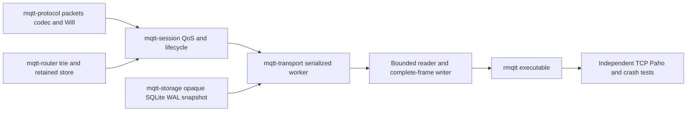

# Architecture — revision4 / Phase2c

TCP MQTT3.1.1 QoS0/1/2, Retained Messages and connection-bound Last Will are
implemented using one bounded SessionEngine/outbox pipeline in both volatile and
SQLite modes. Persistent non-clean sessions require --storage-path. MQTT5,
credentials/auth/ACL, TLS and WebSocket remain unsupported. Full MQTT conformance
and production-readiness are not claimed.

## Modules and dependency graph

lib.rs contains docs/module declarations/reexports only. Protocol splits packet,
codec,error; Router has filter,trie,retained; Session has error,identifiers,incoming,
outgoing,durable plus durable records/lifecycle/retention helpers; Storage has
model,error,trait,memory,durable; Transport has config,server,packet_io,durable.
The previous duplicate live state/connection production path was retired; its
meaningful regressions now exercise the shared runtime.

Each writer specialist uses an isolated Git worktree/branch. Coordinator owns
contracts, CLI, architecture/progress and final cherry-pick integration. Current
phase2c contract supersedes only changed phase2b/phase2a boundaries; prior contracts
and progress preserve history. Public import paths stay stable except the additive
Will type/CONNECT field and max_retained config field documented in this phase.

## Serialized transaction and network lifecycle

Incremental decoding bounds full packet bytes. Fair readiness selection and a
bounded full-frame writer preserve control-read progress and frame integrity.
Commands use bounded mpsc(capacity=max_connections) to one spawn_blocking worker
owning SessionEngine, optional SqliteStore and online generation/notification maps.
No SQLite IO runs on async workers; no routing lock spans an await.

A mutation clones the engine, applies an event, retries eligible pending Wills,
validates/snapshots, commits SQLite if enabled, installs the proposal and only then
exposes ACKs/outgoing packets. Failure discards the complete proposal; SQL failure
cancels service rather than falling back to memory success. Empty unchanged polls
neither commit nor notify. Even Poll(None) commits/notifies if Will retry progressed.

| Event | Atomic effects before response/transmission |
| --- | --- |
| CONNECT | Session create/resume/reset, old connection Will if takeover, new Will registration |
| SUBSCRIBE | Subscription grants and retained replay queued before SUBACK |
| Incoming QoS1 | Retained update/delete if flagged plus all accepted recipient outboxes before PUBACK |
| Incoming QoS2 PUBLISH | Pending original wire packet before PUBREC |
| PUBREL | Incoming removal, retained update/delete and all recipient outboxes before PUBCOMP |
| Outgoing first PUBLISH | Queue removal and allocated ID/stage before transmission |
| PUBREC | AwaitComp before PUBREL; repeat PUBREC repeats PUBREL |
| PUBACK/PUBCOMP | Final removal/ID release before later allocation |
| Normal DISCONNECT | Active Will cancellation/session end before closing |
| Unexpected end | Session end plus Will fanout/retained update, or preserved pending intent |

Incoming/outgoing ID namespaces are independent. Existing QoS primitives/allocator
are reused. Reconnect replays unresolved PUBLISH with original ID, DUP=true and
original send order; AwaitComp replays only PUBREL. Source DUP is never a business
message deduplication key. Incoming repeated/unknown PUBREL never re-routes.

Every handle/poll/end checks network generation. Takeover replaces/cancels the old
registration only after the old-Will/new-session transaction succeeds. Stale cleanup
cannot affect the replacement. Reader submits a graceful worker end on DISCONNECT
and clears identity after success, preventing a second unexpected cleanup. EOF,
RST, writer/protocol error, Keep Alive timeout and server shutdown use unexpected
end. Writer is aborted on close; only an actually queued pre-CONNECT refusal
CONNACK flushes. Successful outgoing ACK invalidates obsolete local replay frames.

## Retained and Will semantics

RetainedStore is global, bounded by count and logical topic/payload bytes, and reuses
existing topic/filter/$SYS matching. Empty payload deletes, nonempty replaces exact
topic. RETAIN=0 never changes stored state. Session reset/disconnect never deletes
global retained messages. Established live/outbox forwarding uses retain=false.
An accepted new or identical replacement subscription replays retain=true with
QoS=min(stored,grant). Filters within SUBSCRIBE are processed sequentially, so each
matching filter may replay a copy; ordinary live routing deduplicates using maximum
matching subscription QoS. Full replay aborts the proposed event without success ACK.
Retained replay retain flags survive queued/outgoing persistence and DUP retransmit.

CONNECT Will is a binary payload with QoS0/1/2 and optional retain, bound to the
accepted network connection. Its publication/removal shares the existing outbox
transaction. The old Will publishes on takeover before replacement registration.
Normal DISCONNECT suppresses it. A closing clean source is removed before fanout;
a persistent source is offline and may queue its own QoS>0 Will. Retained Wills use
the same replace/delete rule; active registration alone does not alter retained state.

Capacity failure never drops or partially publishes a Will. A bounded pending
record retries after progress. A same-ID CONNECT carrying a new Will is refused
while the older pending intent cannot drain; a no-new-Will reconnect can resume and
drain its own full outbox while preserving that older record. Normal/abnormal end
of that no-Will connection cannot erase or duplicate the older intent. Active or
pending definitions are persisted even for clean-session origins with SQLite.
Startup marks loaded active Wills pending, tries publication and commits before
serving clients; remaining capacity-blocked intents stay recorded. Volatile process
death loses all memory state; SQLite process recovery defers Wills until restart.

## Snapshot, ownership and quotas

SQLite WAL/FULL and singleton opaque container schema remain version1, protected
by the existing permanent canonical `.broker-lock` OS advisory lock. Business JSON
is now schema2: persistent sessions plus required global retained and wills arrays.
Queued Message adds retain. Will records are client_id,pending,will(topic,payload,
qos,retain); retained records are topic,payload,qos and never empty. Valid schema1
is explicitly decoded with its old DTOs and migrated to empty globals/retain=false;
old retained wire that schema1 could not store is rejected. Schema2 strictly
validates fields, uniqueness, packet IDs/stages/order/topics and restored quotas.
All restored sessions start offline; online maps/generations/replay cursors are
runtime-only. Unknown/corrupt records fail startup rather than resetting state.

CLI/BrokerConfig bound connections, sessions, Will count, retained topics, queues,
subscriptions, inflight, packet bytes, serialized live/snapshot bytes and IO timers.
Whole-state limits include clean sessions and global data. Count/byte limits are
not an aggregate process-memory/disk budget; bitmap/clone/JSON/staging copies remain
bounded additional costs. Per-proposal Router rebuilding and per-pending-Will
clones are correctness-first choices with unmeasured costs. Worker/storage waits
can delay controls; broad stress/latency/performance work remains open.

SQLite checks BLOB length before allocation and rejects foreign/container schemas.
Sidecar ownership excludes cooperating concurrent brokers; existing symlinks share
the canonical lock, dangling links are refused. Hard-link aliases/external active
DB renaming/replacement/modification are unsupported. Physical power-loss behavior
and application-side exactly-once processing are not claimed by process SIGKILL or
SQLite page-quota SQLITE_FULL tests.

## Verification and history

Actual commands/results and provenance are in progress.md; remaining dependencies
are in tasks.md. Independent tests use ACKs/PING or confirmed recipient output as
commit barriers. They cover both modes, Will normal/abnormal/timeout/takeover,
retained update/delete/replay, transaction rollback, restart and real schema1 DB
migration. lib.rs declaration-only policy and strict Rustdoc are checked.

Normative references: OASIS MQTT3.1.1 sections3.1.2.5–7,3.3.1.3,3.8.4
(https://docs.oasis-open.org/mqtt/mqtt/v3.1.1/os/mqtt-v3.1.1-os.html);
SQLite WAL/FULL (https://www.sqlite.org/wal.html,
https://www.sqlite.org/pragma.html#pragma_synchronous).

Revisions1/2 delivered QoS0 then live QoS1/2. Revision3 added persistent sessions,
SQLite atomic outboxes/recovery, followed by thin-library structural refactoring.
Revision4 adds global Retained and connection Will using the same persistence path,
explicit schema1->2 migration and shared volatile/durable runtime.
