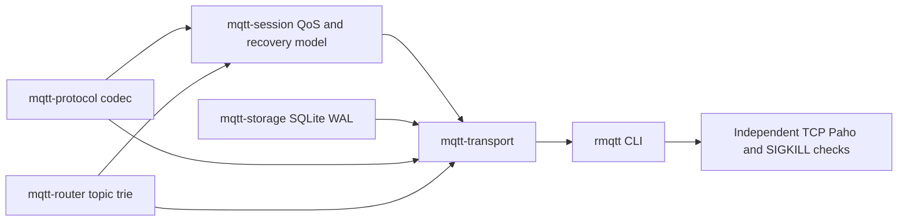

# Architecture — revision 3 / Phase2b

The broker supports TCP MQTT3.1.1 QoS0/1/2 with optional SQLite-backed persistent
sessions. Without --storage-path, the established clean-session path remains.
MQTT5, Retained, Will, credentials/auth and TLS remain unsupported. Full MQTT
conformance and production-readiness are not claimed.

## Dependencies and ownership

Specialists own separate crates/tests in explicitly isolated branches/worktrees;
coordinator freezes contracts, owns CLI/docs and cherry-picks validated commits.
Current contract phase2b supersedes only the persistence boundaries of phase2a;
phase1/phase2a contracts and progress remain historical evidence.

## SQLite-enabled runtime

Network readers use the existing incremental codec and bounded buffers. Each
connection has a bounded complete-frame writer queue; fair readiness selection
avoids starving control reads. The network submits commands through a bounded
mpsc queue (capacity=max_connections) to one spawn_blocking worker. That worker
owns SQLite, the live SessionEngine and runtime generation/notification maps.
No disk IO executes on Tokio async workers; no shared lock spans an await.

For each mutation the worker clones the engine, applies the event, validates and
serializes a snapshot, commits SQLite, installs the clone, updates generation
registration, and only then returns packets. Model/quota failure discards the
entire proposal. SQL commit failure cancels connections and stops the durable
service; there is no memory-only fallback. Empty polls neither commit nor notify.
Committed handle/connect events wake recipients through watch notifications.

The SQLite row contains one schema1 JSON registry of persistent sessions, including
subscription grants, incoming QoS2 messages, ordered outgoing IDs/stages, and queued
recipient messages (the outbox). Online flags, generations and replay cursors are
runtime-only. Restore validates schema, IDs, QoS, complete packet/filter limits,
counts and bytes; all restored sessions start offline. Unknown/corrupt versions
fail startup rather than resetting records.

## Commit and delivery invariants

| Event | Commit before exposing response |
| --- | --- |
| Non-clean CONNECT | Restore/create session, then CONNACK with correct Session Present |
| Clean CONNECT | Discard old persistent record, create volatile session, CONNACK present=false |
| SUBSCRIBE/UNSUBSCRIBE | Subscription changes before SUBACK/UNSUBACK |
| Incoming QoS1 PUBLISH | Route into all accepted recipient outboxes before PUBACK |
| Incoming QoS2 PUBLISH | Pending inbound message before PUBREC |
| Incoming PUBREL | Remove inbound state and enqueue all recipient outboxes atomically before PUBCOMP |
| Outgoing PUBLISH | Queue removal and allocated ID/stage before wire transmission |
| Outgoing PUBREC | AwaitComp before PUBREL |
| Outgoing PUBACK/PUBCOMP | Remove exchange/free ID before later allocation |

Existing IncomingQos2/OutgoingQos/PacketIdentifiers are reused with snapshot/order
support; no independent second QoS state machine was introduced. Existing Router
matching supplies maximum overlapping subscription QoS; delivery uses min of that
grant and publication QoS. Inbound and outbound IDs are separate namespaces.

Persistent disconnect keeps subscriptions, pending inbound/outbound state and
bounded offline QoS1/2 queues. Clean disconnect removes the volatile session.
Reconnection replays unresolved PUBLISH in original send order with original ID
and DUP=true; AwaitComp replays only PUBREL (fixed flags0x2). Previously unsent
queued messages use new IDs/DUP=false. Duplicate/unknown PUBREL never re-routes.
No periodic retry timer substitutes for reconnect retry. QoS0 is dropped offline.
A full durable outbox aborts the entire publication event without success ACK;
there is no partial fanout installed on another recipient.

Runtime worker checks generation on every handle/poll/cleanup. Successful takeover
cancels the predecessor only after its replacement state commits; stale cleanup
cannot remove the new session. Successful outgoing ACKs discard obsolete local
not-yet-queued replay frames so PUBLISH cannot follow its PUBREL. Already queued
frames keep strict writer order. Takeover/shutdown/timeout/error closes the writer
instead of draining stale data; only an actually queued pre-CONNECT protocol
rejection CONNACK receives a bounded flush before close.

## Storage, limits and remaining costs

SqliteStore uses rusqlite0.41 with bundled SQLite, verifies WAL and synchronous=FULL,
and commits one atomic opaque row. It rejects foreign schemas and checks BLOB
length before allocation. A lifetime OS lock on a permanent canonical-path
.broker-lock sidecar rejects cooperating concurrent brokers. The sidecar is not an
existence lock and is not deleted; process termination releases the OS lock.
Existing symlinks resolve to a shared lock; dangling symlinks are rejected. Hard
links, externally renaming/replacing or modifying an actively owned DB are outside
the supported ownership model. Directly locking the DB inode was rejected after
reproducing interference with SQLite's own locks on Darwin.

CLI/BrokerConfig bound connections, sessions, subscriptions, packets, queues,
inflight, snapshot/live serialized bytes and handshake/write deadlines. The
allocator has a fixed65,536-byte bitmap per session; state cloning/serialization
needs additional bounded copies. Whole-registry JSON commits and rebuilding the
existing trie per routed proposal intentionally favor reviewable correctness over
write/CPU efficiency. No throughput/latency/memory baseline has been measured.
Disk quotas, row-level transactions/migrations, backups/admin APIs, continuous
fuzzing and broad stress testing remain follow-up work.

The legacy clean-only path still has short synchronous routing locks and one-task
socket writes; an active legacy write can delay cancellation to write_timeout.
Durable writer cancellation is tested with a blocked real TCP socket, but worker
transaction waits can still delay control handling. Operational deadlines under
slow/failing storage require further work. SIGKILL and SQLITE_FULL tests verify
process/storage failure cases, not physical power loss or application-side
exactly-once processing. SQLite durability depends on filesystem sync semantics.

## Verification and references

Progress records actual test commands/results and specialist commit provenance.
Independent tests use protocol ACKs or confirmed recipient delivery as commit
barriers, never sleeps as proof of durability. Existing basic/QoS/Paho suites run
against both network paths. Task dependencies and unfinished requirements are in
docs/tasks.md.

- MQTT3.1.1: https://docs.oasis-open.org/mqtt/mqtt/v3.1.1/os/mqtt-v3.1.1-os.html
- SQLite WAL: https://www.sqlite.org/wal.html
- SQLite sync: https://www.sqlite.org/pragma.html#pragma_synchronous

Change log: revision1 delivered QoS0; revision2 added live QoS1/2, bounded memory
transactions and CLI controls; revision3 adds versioned durable records, atomic
outboxes, clean reset, offline queues, reconnect replay and crash recovery tests.
