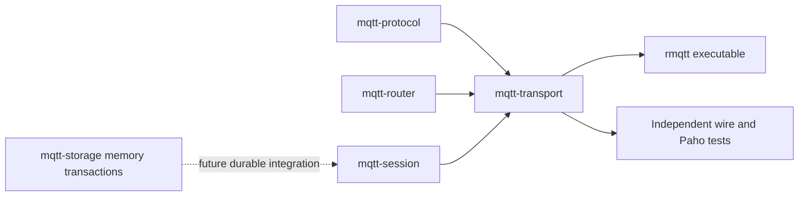

# Architecture — revision 2

The current executable supports TCP MQTT3.1.1 live clean-session QoS0/1/2.
MQTT5, persistent sessions, Retained, Will and credentials remain unsupported.
No full protocol or production-readiness claim is made.

## Module and data dependencies

TCP -> bounded incremental protocol decoding -> connection state machine -> short
synchronous routing lock / iterative topic trie -> bounded per-client queue ->
per-connection outgoing QoS state -> encoding -> bounded-time socket writes.
The coordinator executable supplies CLI resource configuration, bind and shutdown.
No routing lock spans an await. Routed application data is shared using Arc;
recipient packet identifiers are assigned when its queue is drained. The connection
select uses fair scheduling so continuous deliveries cannot starve control reads.

## QoS and lifecycle invariants

Incoming and outgoing Packet IDs occupy independent namespaces per connection.
Incoming QoS1 routes then PUBACKs; duplicates may be forwarded again. Incoming
QoS2 stores the complete application message and returns PUBREC; PUBREL takes the
stored message once, routes it and returns PUBCOMP. Repeated/unknown PUBREL returns
PUBCOMP without delivery; completed IDs can name a new exchange regardless of DUP.

Outgoing QoS1 retains its ID until PUBACK. Outgoing QoS2 waits for PUBREC, releases
its PUBLISH bytes, sends PUBREL and retains its ID until PUBCOMP. Duplicate PUBREC
repeats PUBREL with fixed flags 0x2. Known-ID ACKs in the wrong stage close the
connection; unknown outgoing ACKs are ignored. The router grants requested QoS and
returns the maximum matching subscription grant; outgoing QoS is the minimum of
this grant and publication QoS. Overlapping filters produce one delivery.

Each direction has a bounded inflight window. A full outgoing window pauses queue
draining but continues ACK reads. Queue overflow cancels the slow recipient.
Inbound QoS2 window rejection closes without PUBREC. Keep Alive is based on
complete incoming MQTT packets, not raw bytes. Generation checks under the routing
lock prevent superseded connections changing subscriptions or routing messages;
old cleanup cannot remove the replacement identity.

States are volatile and discarded with clean connections. Reconnect retry depends
on future persistent sessions; periodic retries inside an active TCP connection
are not substituted for that work. SQLite integration requires a versioned record
schema, atomic state/delivery-intent transaction, durable ACK ordering and bounded
blocking workers. MemoryStorage batch atomicity is independent groundwork only.

## Resource and verification boundaries

BrokerConfig/CLI bound full packet bytes, connections, queues, subscriptions,
inflight, handshake time and socket write time. Numeric overflows and invalid
limits fail. An individual socket write can defer cancellation/shutdown/Keep Alive
until write_timeout; slow-reader stress and improved interruptibility are still
pending. Router node capacity retains historical peak allocation and is reused.
No CPU/memory/latency/throughput baseline has been measured.

Current contracts: `docs/contracts/phase2a.md` supersedes only the changed portions
of historical `phase1.md`. Tests cover malformed/fragmented packets, wildcard and
system-topic routing, lifecycle, control-read fairness, QoS state machines and real
Paho interoperability. See progress for exact results and tasks for remaining work.

Normative reference: https://docs.oasis-open.org/mqtt/mqtt/v3.1.1/os/mqtt-v3.1.1-os.html
Future MQTT5 reference: https://docs.oasis-open.org/mqtt/mqtt/v5.0/os/mqtt-v5.0-os.html

## Change log

- Revision1: frozen QoS0 contracts and isolated specialist implementations; initial
  executable accepted in commit 76853ea, with session/storage groundwork separate.
- Revision2: add live QoS1/2 codec, reuse IncomingQos2 and PacketIdentifiers, add
  outgoing ACK state and QoS trie metadata, integrate session into transport.
  Add atomic bounded memory batches and CLI limits. Remove encoder validation via
  full decode; fix verified delivery/read starvation. Persistent runtime remains
  separate future work. Exact specialist/integration commits are in progress.
