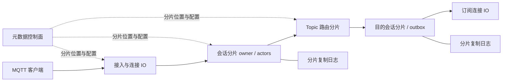

# 大规模 MQTT 集群方案评审

日期：2026-10-30。代码基线：`89293dc`，含 Phase4b 热路径优化。
状态：**架构提案，尚未冻结实现契约；没有集群实现或集群性能实测。**
目标负载由用户确认：高频消息、大量点对点 Topic。优先精确 Topic、低 fanout，
兼容 MQTT 通配符、共享订阅及既有双版本语义。部署先限定单地域；跨地域采用独立
集群与显式桥接，不把 WAN 放入同步提交链路。百万至千万连接是规划场景，不是容量承诺。

## 1. 推荐结论

采用 **会话分片 + Topic 路由分片 + 分片复制日志 + 小型元数据控制面**。
初期同一进程部署多种角色，保留现有 per-client actor；达到隔离资源的必要性后再
独立部署角色。避免一开始就建设很多微服务。

- 会话状态按 `(namespace, ClientId)` 分片，一个有效 owner 执行一个 actor。
  namespace 初期可固定为默认值；不能改变现有 ClientId 的协议作用域。
- 精确 Topic 按 `(namespace, topic)` 分片。路由只记录目标会话分片及其兴趣，
  在目的分片展开到客户端；不把所有客户端订阅复制到所有接入节点。
- MQTT 解码、连接流控、Topic Alias 保留在连接侧；QoS、订阅与 outbox 状态由会话 owner 管理。
- 少量控制面节点负责成员、分片放置和配置；逐条 PUBLISH、PING、ACK 不查询控制面。
- 耐久状态使用多个独立复制组，候选为每组三副本、跨故障域放置；不存在一个承载
  全部消息的 Raft leader，也不为每个客户端创建一个 Raft 组。
- 高性能不等于取消可靠提交。短暂在线 QoS0 与明确承诺故障恢复的耐久流量分别测量；
  MQTT QoS 数值本身不代表服务端已经跨节点持久化。

图中是逻辑角色，箭头不一定跨机器。初版精确路由通过权威 Topic 分片查询/转发，
源、路由、目的各在不同节点时需要两次数据转发，此外还有复制链路。接入和 owner
不在同节点时还会增加连接转发。不能提前宣称所有消息只经过一次跨节点传输。

## 2. 现有能力及复用边界

| 当前实现 | 可复用部分 | 集群缺口 |
|---|---|---|
| `mqtt-transport/src/durable/actor.rs` | 单 ClientId actor、proposal/commit/install | 分片归属、旧 owner 隔离、跨节点命令 |
| `mqtt-session/src/durable/partition.rs` | 会话、QoS、恢复、过期与 Will 状态机 | 可复制命令、稳定内部消息 ID、跨分片转发记录 |
| `mqtt-transport/src/durable/broker.rs` | 分片本地 registry、收件人 admission | registry 仅本进程有效，fanout 仅本地 inbox |
| `mqtt-router/src/index.rs` | 本地 MQTT filter 匹配与收件人选项 | 当前单 RwLock；匹配时复制/排序 ID 和共享成员 |
| `mqtt-router/src/retained.rs`、`concurrent.rs` | Retained 规则与过期 | 查询全表扫描，外层 Mutex；需分片和分页 |
| `mqtt-storage/src/durable/service.rs` | 有界提交、提交后回复、迁移检查 | 一个本机 SQLite writer；没有复制或 fencing |

Phase4 已取消跨会话全局原子 outbox：收件人独立 admission，满队列只拒绝该副本；
QoS0/Will 提交与 fanout 之间的崩溃窗口仍存在。集群不能继承旧阶段的全局原子承诺。
Phase4b 已减少边界检查中的 Serde 和无效索引更新，不应重复开发这些优化。
旧的高 p99 测试早于当前基线，不能用来声称当前版本仍有相同瓶颈或据此外推集群容量。

## 3. 会话放置、连接路径与防双主

使用固定虚拟分片空间，分片到副本组的映射可迁移；不要直接使用 `hash % 节点数`，
否则增减节点会大范围改变会话位置。虚拟分片数、复制组数分别配置，先测它们的
调度、心跳和快照成本，再决定默认值。避免每连接向 etcd 写租约。

优先让连接与 session owner 同机。普通 L4 LB 不能读取 MQTT ClientId，无法自动保证
这一点：初版接受有界的接入到 owner 转发，并统计转发比例。后续再评估能解析 CONNECT
的分片感知入口；它必须处理 TLS 终止、分段报文、Assigned Client Identifier、认证和
背压，不能把它画成免费组件。MQTT5 Server Reference 只能作为可选能力，不能依赖
所有客户端或 MQTT3.1.1 客户端支持重定向。

所有会话命令带 `(shard_id, ownership_epoch, connection_generation)`。
epoch 是复制状态中的单调代次，存储提交与收件方校验；generation 隔离同一会话旧连接。
RPC 的当前发送权限 epoch 与消息创建时的 source incarnation 分开：新 owner 重放旧
outbox 时使用当前权限 epoch，但保持原 publication ID，不能误拒合法恢复任务。
仅靠成员发现、租约或关闭旧 TCP 不足以 fencing。失去多数派的一侧不得成功完成耐久
写入、接管或 Will claim；旧 owner 恢复后必须同步状态再提供服务。
本地未提交计算不能产生成功 ACK 或新的外部消息发送；已经进入网络的数据不可撤回，
接管仍按 MQTT 的重传、DUP 和 QoS 状态机处理，不能承诺不存在网络中的旧包。

迁移采用 learner 追日志、快照校验、追平、复制成员变更和 owner 切换；切换点前后的
outbox、入站 QoS2、Packet ID、订阅版本、定时器和 Will 都必须进入同一恢复边界。
不能只搬 ClientId 和订阅表。

## 4. 高频点对点路由

精确 Topic 用完整 Topic 的 hash 选路由分片，避免全部使用首层前缀而造成热点。
权威分片保存目标分片兴趣与版本；消息按目标分片合并，每份 payload 到目标一次，
然后本地匹配收件人，保留 No Local、RAP、Subscription Identifier、重叠订阅规则。
客户端粒度的匹配结果不在整个集群广播。

通配符不能简单 hash 到某个完整 Topic：初版使用独立 wildcard 索引分区及有界查询，
明确它可能多分片匹配；后续按固定前缀剪枝。`#`、`+` 和 `$` 隔离规则不能为了路由
优化而改变。Shared Subscription 由 `(namespace, group, filter)` 对应的调度权威选择
一次目标，不能各节点独立 round-robin；已开始的 QoS2 不可随意重新分配业务副本。

SUBSCRIBE 的本地会话提交与路由兴趣安装不是一个数据库事务：需要耐久注册 intent、
幂等注册、会话激活和明确恢复流程。成功 SUBACK 前，所有必要精确/通配符兴趣必须
达到可路由状态。取消订阅的旧路由允许多转发，但目的 owner 必须再检查当前订阅，
不能错误交付。注册中途故障不得出现已返回 SUBACK 却没有路由的空洞。
目录或 wildcard 分区查询失败不能当作“无订阅”；转发携带路由版本及订阅代次，
目的端校验陈旧兴趣，并与 shared 的唯一分配代次分开处理。

**路由缓存是后续优化，不能使用无屏障的异步缓存。** 高频精确 Topic 可缓存目的分片，
目标是命中后源到目的直接转发。但新订阅必须使旧负缓存/旧目的集合失效或等安全期限
结束后才能 SUBACK，且要解决 owner 迁移和控制面 watch 断档。初版每次经权威路由分片
更容易验证；在订阅可见性、失效协议和故障测试通过前，不启用直达缓存。

热点 Topic 不会因 hash 自动被拆开。若未来出现高 fanout，可引入分层转发、分片内
批次共享 payload；同一有序流的排序点仍有限，不能以打乱消息顺序换吞吐。

## 5. 耐久交付、ACK 与复制

建议新增独立集群耐久契约，**不得直接改变现有 Phase4 ACK 行为**：

1. MQTT Packet Identifier 只用于对应连接/会话的协议状态。内部使用稳定的 publication
   ID，例如持久 source shard ID + source incarnation + 已提交序列，重试/迁移不改 ID。
2. 源分片原子提交入站 QoS 状态、payload 或耐久引用、目标路由决策/版本和转发 outbox。
   复制达到规定提交点之后才具备成功回复的资格。
3. 目的分片原子提交收件去重标记与对应会话队列/出站状态，然后返回 durable receipt。
   回执区分耐久接纳、明确拒绝、结果未知；只有耐久接纳可直接完成转发责任。
   超时代表未知，不能当成功，按稳定 ID 重试。源已成功 ACK 后，目的暂时满载只能
   重试；永久策略拒绝、订阅变化或过期须按冻结规则产生可审计的复制终止记录，
   不能收到任意负回执就删除 outbox。
4. QoS1 的 PUBACK、QoS2 的 PUBREC/PUBREL/PUBCOMP 分阶段定义提交点，保留现有
   QoS2 状态机；不能把 PUBREC 当作业务交付完成，也不能对外承诺全局业务 exactly-once。

待冻结的关键决策：源成功 ACK 是等待目的 admission，还是仅等待已复制的转发责任。
建议大规模版本选择后者，使慢目的不阻塞发布者；这是 Phase4 的契约变化，不是实现细节。
该 ACK 表示 broker 已耐久接纳责任，**不是所有订阅应用已收到消息**。
没有目的地的消息、Quota 拒绝、消息过期等须有单独明确处置。

源 outbox、收件人队列、重试与磁盘空间全部有界；未接纳时按版本与报文阶段明确拒绝
或断连。已耐久接纳的任务不能因重试次数耗尽就静默删除：保留责任直到交付、协议允许
的过期或已定义的终止策略。必须先定义容量预留、磁盘高水位与终止策略，再宣称故障下
不丢已接纳消息。QoS0 默认不增加同步磁盘复制，不能顺带承诺其故障恢复。

去重记录不能按固定短 TTL 随意清除：要结合源 outbox 确认水位、epoch 和快照回收，
避免旧重试到达后再入队。载荷先采用随记录复制，先不引入分布式对象存储的引用回收问题。
点对点 fanout 接近 1 时收益有限，后续出现广播才评估共享日志载荷加游标。

复制状态机不能依赖各副本独立读取当前时钟/随机数/ACL：命令携带 leader 决定的
有效时间、策略版本和业务决策；到期及 Will 的执行也必须经复制状态机 claim。
不复制 socket、Topic Alias、Tokio task 或不可重放的进程内对象。

## 6. Retained、Will、恢复与分区

- Retained 由完整 Topic 的权威分片排序更新，删除与过期需要有版本的 tombstone，
  旧副本追平前不能复活数据。通配符回放跨分片分页，限制并发/内存，定义快照水位及
  实时消息交叠规则；不能承诺全局瞬时快照却不付出协调成本。
- Will 在会话分片中存储 deadline 和发布责任；重连取消、Session Expiry、claim 和
  生成稳定 publication ID 原子化。选主重放必须幂等。提高到耐久 Will 是新的保证，
  当前 Phase4 的 at-most-once 窗口不会因为增加副本自动消失。
- 单个副本/可用区故障的 RPO 0 仅适用于规定多数派提交后的记录，并取决于副本放置、
  fsync 和故障模型。丢失多数副本、整地域失效或损坏不是同一个承诺。
- 少数派允许何种只读/短暂 QoS0 服务另行定义；不得在两侧都恢复同 ClientId 或发布 Will。
- TLS/mTLS、节点身份和授权必须进入跨节点链路上线门槛；当前明文单机测试部署不能
  直接扩为不受控节点可加入的生产集群。

## 7. 技术选型边界

| 方案 | 判断 |
|---|---|
| 全节点复制所有客户端订阅、全互联广播 | 不作为大规模目标；状态与订阅抖动随节点数放大 |
| 元数据控制面 + 多分片数据面 | 推荐；控制面不是每条消息的协调点 |
| etcd | 候选用于放置/配置；不存全部逐客户端 lease，不承载每条消息或 outbox |
| OpenRaft + 本地存储 | 复制组候选，先验证持久日志、快照、成员变更、崩溃与批量提交；不是接入库就有集群 |
| SQLite | 保留现有单机后端/迁移入口；共享 SQLite 文件或复制文件不等于分布式事务 |
| RocksDB/其他 WAL+KV 后端 | 需实测写放大、恢复时间、压缩与运维成本后选择；不在此提案中直接替换耐久格式 |
| Kafka/Redis 作为所有消息的统一中心 | 不作为默认关键路径；会新增协调/跳数，且不会自动解决 MQTT 会话和 QoS |

OpenRaft 官方标明 1.0 前 API 不稳定。需隔离适配层、固定版本和验证存储契约，
schema 兼容、快照原子安装和升级恢复由项目负责，不能外包给库名。

## 8. 可验证的性能与可靠性验收

先用当前 `89293dc` 重建单机基线，再比较同核数/硬件/耐久等级；旧测试不能当新代码数据。
分别报告 ingress publish/s、实际 delivery/s、ACK/s、成功率与拒绝原因，不能混为 TPS。

| 维度 | 必须包含 |
|---|---|
| 规模 | 单机、3、6、12 数据节点；固定客户端/节点与固定总负载两种比较 |
| 主负载 | 精确 Topic 点对点，fanout=1；128B/1KiB，QoS0/1/2，双版本 |
| 数据局部性 | 同机、50%、100% 跨节点；接入-owner 转发率单独控制 |
| 路由规模 | 大量唯一 Topic、百万级订阅、负缓存、新增/取消抖动 |
| 扩展负载 | wildcard、shared、小比例慢收件人；热点 fanout 另报 |
| 指标 | offered/send/delivery TPS，schedule->delivery 与 send->delivery 的 p50/p95/p99/p99.9 |
| 资源 | 每核 CPU、RSS/PSS、字节/连接、字节/订阅、集群链路和复制字节/消息、磁盘写放大 |
| 拆解 | 入口排队、路由、actor 排队、commit、RPC、出口排队、客户端接收调度 |
| 故障 | 杀 leader、切断网络、旧 owner 回归、丢 receipt、满磁盘、迁移中崩溃 |

先固定 offered rate 和延迟 SLO 再寻找容量：每档必须完成足够长的稳定区间并报告
样本量、排队斜率和未发送计划数；不能用无限闭环满压的单个 p99 定义用户体验。
最终数值 SLO、恢复时间和可接受成本仍需产品约束；当前不填虚构的百万 TPS 指标。
容量模型至少包括：连接/订阅状态、积压、去重水位、复制缓存和迁移峰值，不能只看 socket RSS。
扩容效率使用同负载模型的 `throughput(n)/(n*throughput(1))`，同时展示复制等级和 p99；
没有实验就不能承诺线性扩容。

## 9. 实施依赖和下一轮任务

这次只评审方案，不将未实现的集群标记完成。

1. **C0：冻结契约和基线。** 确定吞吐/延迟/恢复目标、故障模型、ACK 边界、顺序范围；
   固定当前单机二进制与相同客户端数据，建立分阶段耗时和跨节点开销模型。
2. **C1：分片与 fencing。** 单节点实现抽象与旧 epoch 拒绝测试；定义命令格式、
   schema 版本、Clock/ACL 决策重放，现有单机功能不退化。
3. **C2：三副本恢复。** 一个复制组先跑会话/Will/QoS 崩溃恢复、原子快照、选主和失去多数派；
   验证之后再扩为多复制组，避免一次开发整个集群。
4. **C3：跨分片可靠点对点。** 稳定消息 ID、耐久转发 outbox、收件去重与回收；
   实现精确 Topic 注册屏障，补齐丢请求/丢回执/队列满故障测试。
5. **C4：迁移与完整路由。** wildcard、shared、retained 分页、连接接管和分片迁移。
6. **C5：高性能直达路径。** 只有定位了额外路由跳开销后，再实现带屏障的缓存、批量 RPC、
   连接亲和及自适应有界批量；用相同负载与正确性 gates 验证收益。

冻结 C0/C1 后，可让真实专业 Agent 在独立 worktree 并行承担：
会话命令/恢复、复制存储适配、精确路由及兴趣协议；质量 Agent 独立故障 oracle。
接口共享、fencing 和 ACK 决策由协调者先统一，不并行改同一文件。遵守 lib.rs 仅模块与导出。

## 10. 官方资料及推导边界

- [EMQX 集群架构](https://docs.emqx.com/en/emqx/latest/develop/cluster/introduction.html)：
  本地订阅与集群 filter-to-node 路由分离、Core/Replicant。借鉴分离思想；本提案的
  分片目录与复制方式是针对本项目的建议，不表示复刻或已达到其规模。
- [EMQX Durable Sessions](https://docs.emqx.com/en/emqx/latest/guides/durability/durability_introduction.html)：
  区分 RAM 会话与复制耐久会话，说明批量存储的吞吐/延迟取舍。
- [Apache BifroMQ 集群概览](https://bifromq.apache.org/docs/cluster/intro/)：
  按功能分布工作负载、支持同进程或独立部署。支持逻辑角色分离，不证明本项目需立刻拆服务。
- [etcd API](https://etcd.io/docs/v3.6/learning/api/)：CAS 事务、线性一致读与 lease；
  lease 不是数据面旧写者自动隔离机制，仍需 epoch 检查。
- [OpenRaft 文档](https://docs.rs/openraft/latest/openraft/) 与
  [存储接入要求](https://github.com/databendlabs/openraft/blob/main/openraft/src/docs/getting_started/getting-started.md)：
  复制日志及状态机存储由应用正确实现；不能把其当作现成 MQTT 分布式数据库。
