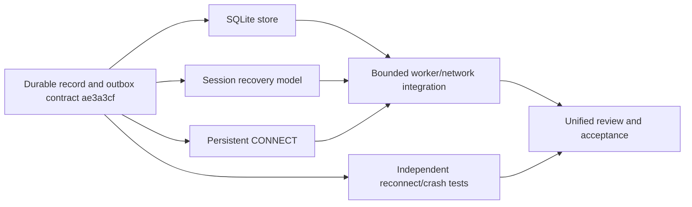
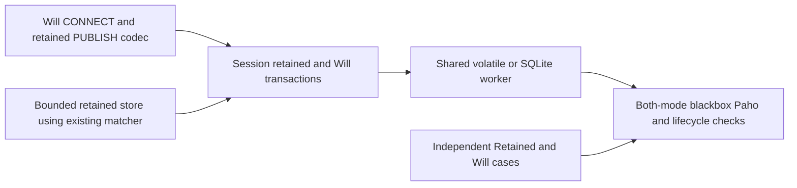
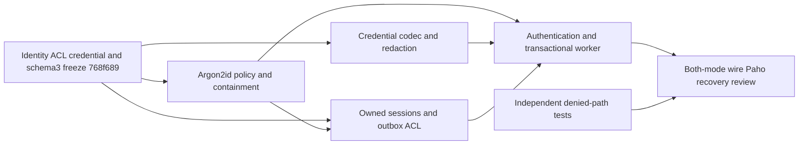
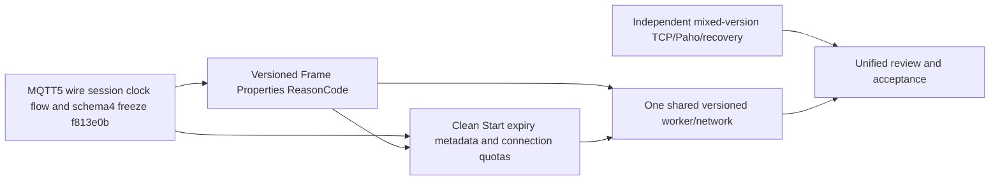
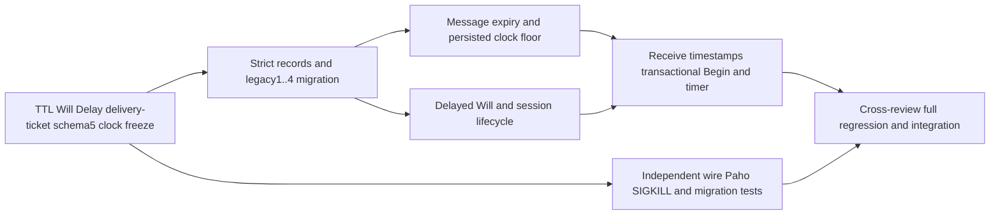
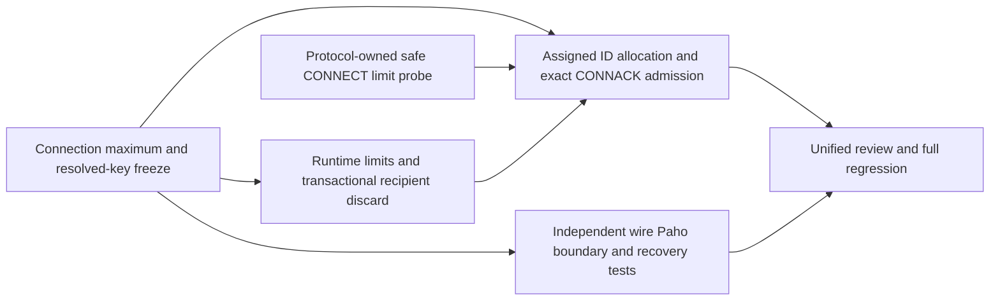
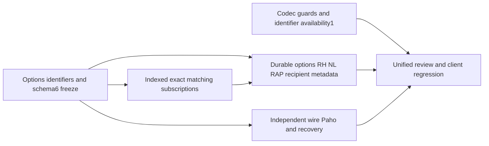
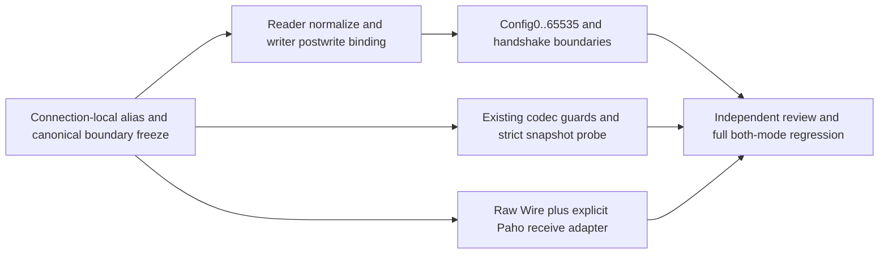
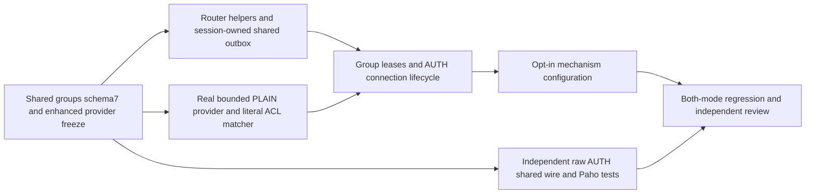
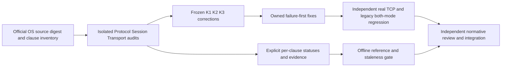

# Task dependencies and remaining work

## Completed, preserving existing implementations

- Phase0/1: workspace, engineering rules/contracts, MQTT3.1.1 QoS0 codec, indexed
  wildcard/system-topic routing, bounded TCP lifecycle, Keep Alive and takeover.
- Phase2a: bidirectional live QoS1/2, bounded Packet ID/window lifetimes, requested
  subscription grants/max matching QoS, atomic memory batches and CLI limits.
- Phase2b: schema1 durable session/outbox contract; SQLite WAL/FULL storage and
  OS writer exclusion; persisted subscriptions, bounded offline queues, ordered
  reconnect replay and clean reset; transactional blocking worker; normal TCP
  disconnect, SIGKILL/restart and SQL rollback tests; both-path interoperability.
- Phase2d: bounded local Argon2id authentication and ACL hooks; CONNECT credentials,
  principal-bound sessions/Wills, schema1/2->3 migration, outbox/Will revocation and
  both-mode independent wire/Paho denial/recovery tests.
- Phase2c: global retained replace/delete/replay, connection Will lifecycle/deferred
  publication, schema1->2 migration, shared memory/SQLite worker, both-mode wire and
  real-client verification. Existing QoS/outbox implementations are reused.

The codec, Router, IncomingQos2, OutgoingQos and PacketIdentifiers were extended or
reused. Storage/session/network were implemented and committed in separate Git
worktrees; final integration and contracts belong to the coordinator.

## Phase2b execution dependency graph

Storage and session implementation proceeded in parallel. Protocol finished early
and its slot was used for independent quality work. Network integration started
from the integrated dependency commits. Reviewers independently audited storage
and session; coordinator/quality audited worker and network. Reproduced ownership,
quota, replay and writer cancellation defects were fixed before acceptance.

## Next single-node features

1. Use the [MQTT5 clause/evidence matrix](conformance/README.md) to drive normative
   acceptance: resolve explicit test gaps, policy exceptions and unnumbered/table
   review before any full conformance claim. Complete broader MQTT3.1.1
   conformance/rejection-code/client-ID edge cases and
   client interoperability before claiming full conformance. Authentication/ACL
   is implemented and verified in Phase2d.
2. Extend the accepted MQTT5 foundation under new semantic contracts:
   Phase2j adds Shared Subscriptions and opt-in SASL PLAIN enhanced AUTH. Broader
   conformance, further mechanisms and operational hardening remain open.
   Typed Properties/ReasonCode, Clean Start/Session Expiry/Receive Maximum and
   cross-version recovery are implemented in Phase2e; MessageExpiry and WillDelay
   are implemented in Phase2f. Phase2g adds MaximumPacketSize negotiation and
   Assigned Client Identifier with durable normal-key resume. Phase2h adds durable
   No Local/RAP/Retain Handling and Subscription Identifiers. Phase2i adds bounded
   bidirectional connection-local Topic Alias.
3. Add TLS transport before exposing password authentication over untrusted networks;
   remote authentication, per-identity rate limiting and policy reload require
   explicit policy-version/control contracts.

## Durability and operational hardening still open

- Row-level/session-scoped transactional records to reduce full-snapshot cloning,
  JSON amplification and per-proposal trie rebuild cost; measure before optimizing.
- Explicit migrations, consistent backup/restore and management/removal of offline
  sessions. Lowered incompatible quotas currently reject startup; they do not evict.
- Bounded control/transaction response deadlines with slow/failing storage; broad
  slow-reader/backpressure/shutdown/fault campaigns, and slow-worker control handling.
- More filesystem/disk-error scenarios, schema/fuzz/corruption corpus and CI matrix.
  Process SIGKILL and storage SQLITE_FULL are tested; physical power loss is not.
- Explicit disk-space/compaction/checkpoint quotas. Snapshot bytes are not a
  complete disk or aggregate process-memory budget. Keep strict single-owner DB
  constraints; hard-link aliases/external active DB modifications are unsupported.
- Policy reload, identity-aware session admin/conversion, tracing/metrics and
  overload/authentication/error observability. Bounded static auth policy files exist.
- Isolate expensive authentication CPU from the state actor and add rate limiting;
  measure full-registry ACL reconciliation and batch ID-pruning costs under load.

## Phase3/4 gates

Continuous fuzz/property testing, broader third-party client matrices, concurrent
hot-topic/large-subscription/slow-consumer workloads, and reproducible CPU/memory/
latency/throughput baselines remain. No performance baseline is claimed. TLS,
WebSocket, containers and admin APIs follow single-node correctness/security.
Cluster architecture remains deferred pending stronger single-node verification.

Full MQTT conformance and application-side exactly-once processing are not claimed.

Module-layout maintenance completed: every lib.rs is a declaration/re-export-only
entry point. Implementations/tests are grouped by responsibility, preserving the
existing public API and durable format. This refactor does not complete or alter
any of the unfinished feature/hardening requirements listed above.

## Completed Phase2c dependency group
Frozen contract: docs/contracts/phase2c.md (05e78a2).

New retained state is global, not client-session-owned. Schema2 adds retained and
connection-Will records and explicitly migrates schema1. Pending capacity-blocked
Wills remain bounded and retry after progress. The network integration reuses one
SessionEngine/outbox pipeline for both storage modes; no parallel competing file
writers. lib.rs remains declarations/reexports only. These tasks passed integrated client/recovery acceptance; see progress.md.

The final review added a recovery liveness boundary: an older capacity-blocked
Will must not permanently prevent the same persistent client draining its own
outbox. No-new-Will reconnect preserves that pending intent; admission carrying a
new Will still refuses overwriting it. Per-connection multi-intent designs and
throughput/fairness optimization under sustained saturation remain future work.

## Phase2d dependency group

All writers have separate branches/worktrees. Existing retained store, trie, QoS
FSMs, storage and transaction/outbox pipeline are reused. This Phase2d group did
not implement cluster/TLS/MQTT5; Phase2e below adds the first MQTT5 semantics. Legacy schemas bind to
anonymous; offline administrative reassignment/removal needs a future explicit
contract. Policy-triggered payload pruning is intentional revocation behavior;
resource-quota incompatibility/corrupt schema still fail startup without resetting.

## Completed Phase2e dependency group

Protocol, Session and Quality started in isolated worktrees; Protocol's released
slot enabled Transport. Protocol then independently reviewed model/network while
owners fixed reproduced defects. No router/storage/auth rewrite was introduced.
Schema4 explicitly migrates1/2/3, preserving identity and canonical QoS stages.
Required nullable expiry fields reject omission; known offline deadlines cannot
be silently refreshed. New metadata participates in state/packet quotas.

Review fixes include exact311→5 envelope growth at packet limits, unavailable
subscription feature disconnects, precise malformed/protocol reasons, early-PUBREC
replay cursor retirement, and actual-write inbound credit accounting. Supported
features/exclusions are in phase2e.md; the next MQTT5 increment must freeze its
optional-feature semantics and compatibility/migration behavior before coding.

Next verification work includes broader direction/reason conformance, small-packet
bridging policies, clock rollback/expiry concurrency, slow-client credit reuse and
terminal-write stress, rolling-version/client matrices and expanded fuzz/fault data.
No benchmark improvement or full MQTT5 compatibility is claimed.

## Completed Phase2f dependency group

Message, Will and Quality wrote separate branches/worktrees with disjoint file
ownership after schema bootstrap. Transport started from integrated model commits;
independent cross-review reproduced clock rollback and CleanStart phantom-recipient
defects before owner fixes. Existing SQLite storage, Clock, router and QoS/outbox
implementations were reused. lib.rs remains module declarations/reexports only.

Accepted behavior includes offline/retained TTL, expired replacement deletion,
QoS2 protocol completion after payload expiry, pre-write suppression, started
exchange recovery, delayed-Will cancellation/session-end interaction and crash
recovery. Strict schema5 migrates1..4 and rejects missing time/start/delay fields.
No performance improvement or full MQTT5 conformance is claimed.

Next hardening: benchmark additional Begin transactions/full-snapshot amplification;
expand repeated clock-jump and crash-at-wire-boundary campaigns; evaluate indexed
deadline scheduling and row-scoped persistence only from measured baselines. The
SQL/TCP start-intent gap and latest uncommitted wire-clock observation remain
explicit boundaries, alongside the operational/conformance tasks listed above.

## Completed Phase2g dependency group

Separate Session, Transport and Quality worktrees start from frozen interfaces;
Protocol uses a released slot for a parser-reusing diagnostic probe. The existing
schema5, SQLite backend, QoS state machines and outbox/expiry/Will paths are reused.
No schema migration or persistent allocator is introduced. Runtime peer caps reset
on every connection/restore; assigned keys become ordinary owned session keys.

At Phase2g, the next protocol work was Shared Subscriptions and enhanced AUTH, alongside the earlier
full-conformance/client-matrix gates. Measure peer-cap scanning/full-encoding and
snapshot costs before optimizing. Existing SQL/TCP crash ambiguity, clock boundaries
and operational/performance tasks remain explicit; no cluster work is introduced.

Independent review acceptance additionally covers max_queued1 oversize copies before
Poll, resumed backlog admission and retained replay without source/healthy-peer
rejection. Reproduced cases were fixed by the Session owner and independently
verified over TCP; genuine fitting-message backpressure remains. Shared Paho close
helpers now wait remote EOF before a causal reconnect, proven by a SQL-lock probe.

## Completed Phase2h dependency group

Separate branches/worktrees preserve module ownership. Existing packet/property
codec, trie, Clock, SQLite/QoS/outbox, expiry, negotiated caps and ACL/Will paths are
reused. Schema6 introduces full subscription records and retained_replay markers;
explicit1..5 migrations preserve prior state with defaults. Any-eligible-RAP live
overlap is a documented broker policy, not a normative or Mosquitto precedence claim.
After Phase2h, remaining protocol work included Shared Subscriptions and enhanced AUTH, plus
broader conformance/client/fuzz/fault verification and operational/performance gates.

## Completed Phase2i dependency group

Three isolated writer worktrees keep Transport, Protocol tests and Quality disjoint;
coordinator owns CLI/docs/integration. No Session/storage/schema rewrite. Native
Paho2.1 does not map incoming aliases, so its alias suite uses a validated explicit
receive adapter before QoS2 caching, with independent raw-wire assertions. Canonical
admission limits remain separate from optional alias compression; aliases cannot
rescue already discarded canonical deliveries. Phase2j below implements Shared
Subscriptions and enhanced AUTH; conformance/fuzz/fault/performance/operations gates
remain unchanged. Measure bounded map scans/encoding and alias memory before tuning.

## Completed Phase2j dependency group

All writers have explicitly assigned independent Git worktrees. Shared/Router and
Auth implement their owned paths in parallel; Transport consumes their committed
APIs. Quality independently tests the executable and maintains strict legacy test
fixtures. Coordinator freezes interface changes, integrates commits, and owns CLI
and documentation. Existing SQLite storage and protocol codec are reused.

Remaining work after this integration: a group-owned QoS1 redelivery spool (current
selected-session policy deliberately omits redistribution after session end), further
SASL mechanisms such as SCRAM, auth rate/CPU isolation, protected TLS transport and
all previously listed conformance/fuzz/fault/performance/operations gates. No cluster
work should precede those single-node correctness and reliability tasks. Runtime
shared group views/trie reconstruction and full snapshots need measurements before
optimization; no new throughput or latency claims are made.

Phase2j acceptance:333 Rust tests,495 real-wire executions and all reused both-mode
Paho suites pass on the final artifact;9 new unmodified-Paho executions cover shared
subscriptions. Strict Fmt/Clippy/Rustdoc, Python compilation and thin-lib checks pass.
An independent actual-wire regression caught illegal reauth DISCONNECT reason86;
owner fix99f4ea5 plus absolute-auth-deadline reason87 was failure-first tested and
revalidated before acceptance. See progress.md for source commits, environment,
artifact digest, actual old-schema6 executable upgrade and explicit limitations.

## Completed Phase2k first audit and corrections

Implemented corrections: pre-acceptance server terminal packet context, sequential
multi-filter UNSUBSCRIBE, and AUTH method presence at public encode/decode boundary.
Additional tests close QoS1 ID reuse, DUP independence, no live unsolicited retry,
ClientID length, second CONNECT, SUBACK order and persistent duplicate-UNSUB cases.
No schema or public API change; schema7/outbox/clock/alias state reused.

Next acceptance order (not a feature-name backlog):

1. Packet identifier uniqueness/reuse and request-response association across every
   control type (`MQTT-2.2.1-3/4/5/6`), including interruption/recovery and wrong stages.
2. Version/protocol-name refusal context and invalid ClientID reason/EOF
   (`MQTT-3.1.2-1/2`, `3.1.3-8`); distinguish optional refusal behavior from MUST gaps.
3. Complete invalid-reserved-bit wire termination matrix for the remaining packet
   types; codec enumeration alone does not certify the connection lifecycle.
4. Mixed RAP overlap (`MQTT-3.3.1-12/13`), adversarial/interleaved ordering
   (`4.6.0-5/6`) and non-normalized Unicode equality (`4.7.3-4`). Resolve interpretation
   before changing the existing documented policy.
5. Exhaustive unnumbered/property-table/direction/context sweep. The candidate
   inventory is heuristic; screening it does not prove every table constraint.
6. Decide whether to replace the shared QoS1 session-owned SHOULD exception with a
   group-owned redelivery transaction, and separately address secure transport.

Keep missing evidence distinct from confirmed implementation defects. A MUST may
never be waived as a policy exception. Every newly confirmed defect needs its own
failure-first regression, frozen correction and owner review. Exact status counts,
actual test results and source hashes belong to progress.md and the generated CSV.

Phase2k final disposition:354 inventoried entries screened,221 evidence-verified,
61 test gaps,70 not-applicable/editorial/aliases and2 SHOULD policy exceptions.
All252 literal numbered entries have a review decision. The102 supplementary
candidates do not exhaust every normative sentence/table value. Three confirmed
code mismatches were corrected; Rust348, wire530 and all Paho regressions pass.
Remaining evidence/interpretation rows, rather than feature availability, drive
subsequent acceptance. Full conformance remains unclaimed.
