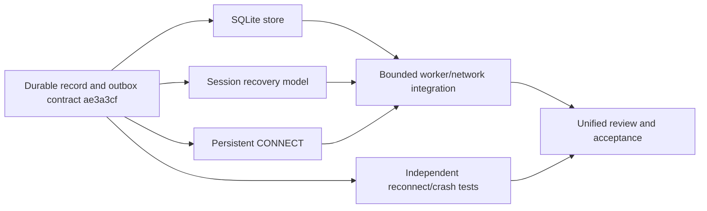

# Task dependencies and remaining work

## Completed, preserving existing implementations

- Phase0/1: workspace, engineering rules/contracts, MQTT3.1.1 QoS0 codec, indexed
  wildcard/system-topic routing, bounded TCP lifecycle, Keep Alive and takeover.
- Phase2a: bidirectional live QoS1/2, bounded Packet ID/window lifetimes, requested
  subscription grants/max matching QoS, atomic memory batches and CLI limits.
- Phase2b: schema1 durable session/outbox contract; SQLite WAL/FULL storage and
  OS writer exclusion; persisted subscriptions, bounded offline queues, ordered
  reconnect replay and clean reset; transactional blocking worker; normal TCP
  disconnect, SIGKILL/restart and SQL rollback tests; both-path interoperability.

The codec, Router, IncomingQos2, OutgoingQos and PacketIdentifiers were extended or
reused. Storage/session/network were implemented and committed in separate Git
worktrees; final integration and contracts belong to the coordinator.

## Phase2b execution dependency graph

Storage and session implementation proceeded in parallel. Protocol finished early
and its slot was used for independent quality work. Network integration started
from the integrated dependency commits. Reviewers independently audited storage
and session; coordinator/quality audited worker and network. Reproduced ownership,
quota, replay and writer cancellation defects were fixed before acceptance.

## Next single-node features

1. Freeze Retained record/query and Last Will lifecycle contracts. Retained
   storage/router work and Will state/protocol support can then run in isolated
   worktrees; runtime delivery must use the existing outbox transaction boundary.
2. Freeze authentication/ACL extension traits and denied-delivery behavior; add
   implementation and independent authorization tests. Credentials are currently
   rejected, not silently accepted as authenticated identities.
3. Freeze versioned MQTT5 protocol/session contracts before parallel codec/runtime
   changes: properties, reason codes, Clean Start/session expiry, Receive Maximum,
   aliases/shared subscriptions, limits and AUTH remain unimplemented.

## Durability and operational hardening still open

- Row-level/session-scoped transactional records to reduce full-snapshot cloning,
  JSON amplification and per-proposal trie rebuild cost; measure before optimizing.
- Explicit migrations, consistent backup/restore and management/removal of offline
  sessions. Lowered incompatible quotas currently reject startup; they do not evict.
- Bounded control/transaction response deadlines with slow/failing storage; broad
  slow-reader/backpressure/shutdown/fault campaigns, plus legacy writer cancellation.
- More filesystem/disk-error scenarios, schema/fuzz/corruption corpus and CI matrix.
  Process SIGKILL and storage SQLITE_FULL are tested; physical power loss is not.
- Explicit disk-space/compaction/checkpoint quotas. Snapshot bytes are not a
  complete disk or aggregate process-memory budget. Keep strict single-owner DB
  constraints; hard-link aliases/external active DB modifications are unsupported.
- Config files/reload, tracing/metrics and overload/error observability.

## Phase3/4 gates

Continuous fuzz/property testing, broader third-party client matrices, concurrent
hot-topic/large-subscription/slow-consumer workloads, and reproducible CPU/memory/
latency/throughput baselines remain. No performance baseline is claimed. TLS,
WebSocket, containers and admin APIs follow single-node correctness/security.
Cluster architecture remains deferred pending stronger single-node verification.

Full MQTT conformance and application-side exactly-once processing are not claimed.

Module-layout maintenance completed: every lib.rs is a declaration/re-export-only
entry point. Implementations/tests are grouped by responsibility, preserving the
existing public API and durable format. This refactor does not complete or alter
any of the unfinished feature/hardening requirements listed above.
