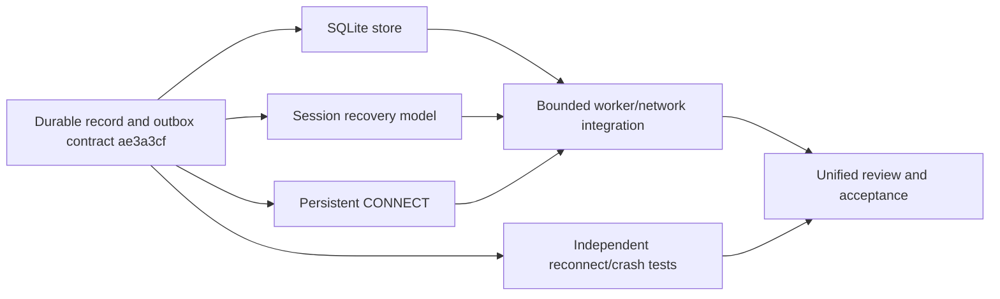
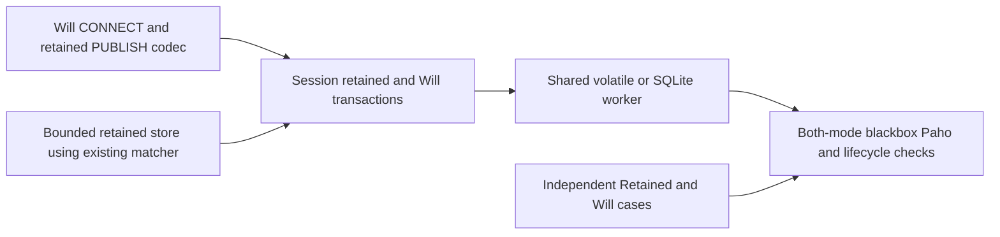
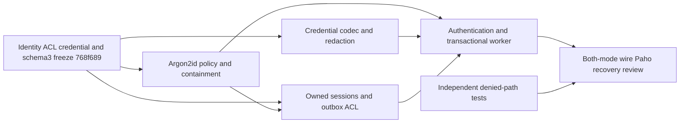

# Task dependencies and remaining work

## Completed, preserving existing implementations

- Phase0/1: workspace, engineering rules/contracts, MQTT3.1.1 QoS0 codec, indexed
  wildcard/system-topic routing, bounded TCP lifecycle, Keep Alive and takeover.
- Phase2a: bidirectional live QoS1/2, bounded Packet ID/window lifetimes, requested
  subscription grants/max matching QoS, atomic memory batches and CLI limits.
- Phase2b: schema1 durable session/outbox contract; SQLite WAL/FULL storage and
  OS writer exclusion; persisted subscriptions, bounded offline queues, ordered
  reconnect replay and clean reset; transactional blocking worker; normal TCP
  disconnect, SIGKILL/restart and SQL rollback tests; both-path interoperability.
- Phase2d: bounded local Argon2id authentication and ACL hooks; CONNECT credentials,
  principal-bound sessions/Wills, schema1/2->3 migration, outbox/Will revocation and
  both-mode independent wire/Paho denial/recovery tests.
- Phase2c: global retained replace/delete/replay, connection Will lifecycle/deferred
  publication, schema1->2 migration, shared memory/SQLite worker, both-mode wire and
  real-client verification. Existing QoS/outbox implementations are reused.

The codec, Router, IncomingQos2, OutgoingQos and PacketIdentifiers were extended or
reused. Storage/session/network were implemented and committed in separate Git
worktrees; final integration and contracts belong to the coordinator.

## Phase2b execution dependency graph

Storage and session implementation proceeded in parallel. Protocol finished early
and its slot was used for independent quality work. Network integration started
from the integrated dependency commits. Reviewers independently audited storage
and session; coordinator/quality audited worker and network. Reproduced ownership,
quota, replay and writer cancellation defects were fixed before acceptance.

## Next single-node features

1. Complete broader MQTT3.1.1 conformance/rejection-code/client-ID edge cases and
   client interoperability before claiming full conformance. Authentication/ACL
   is implemented and verified in Phase2d.
2. Freeze versioned MQTT5 protocol/session contracts before parallel changes:
   properties, reason codes, Clean Start/session expiry, Receive Maximum, topic
   aliases/shared subscriptions, Will Delay and AUTH remain unimplemented.
3. Add TLS transport before exposing password authentication over untrusted networks;
   remote authentication, per-identity rate limiting and policy reload require
   explicit policy-version/control contracts.

## Durability and operational hardening still open

- Row-level/session-scoped transactional records to reduce full-snapshot cloning,
  JSON amplification and per-proposal trie rebuild cost; measure before optimizing.
- Explicit migrations, consistent backup/restore and management/removal of offline
  sessions. Lowered incompatible quotas currently reject startup; they do not evict.
- Bounded control/transaction response deadlines with slow/failing storage; broad
  slow-reader/backpressure/shutdown/fault campaigns, and slow-worker control handling.
- More filesystem/disk-error scenarios, schema/fuzz/corruption corpus and CI matrix.
  Process SIGKILL and storage SQLITE_FULL are tested; physical power loss is not.
- Explicit disk-space/compaction/checkpoint quotas. Snapshot bytes are not a
  complete disk or aggregate process-memory budget. Keep strict single-owner DB
  constraints; hard-link aliases/external active DB modifications are unsupported.
- Policy reload, identity-aware session admin/conversion, tracing/metrics and
  overload/authentication/error observability. Bounded static auth policy files exist.
- Isolate expensive authentication CPU from the state actor and add rate limiting;
  measure full-registry ACL reconciliation and batch ID-pruning costs under load.

## Phase3/4 gates

Continuous fuzz/property testing, broader third-party client matrices, concurrent
hot-topic/large-subscription/slow-consumer workloads, and reproducible CPU/memory/
latency/throughput baselines remain. No performance baseline is claimed. TLS,
WebSocket, containers and admin APIs follow single-node correctness/security.
Cluster architecture remains deferred pending stronger single-node verification.

Full MQTT conformance and application-side exactly-once processing are not claimed.

Module-layout maintenance completed: every lib.rs is a declaration/re-export-only
entry point. Implementations/tests are grouped by responsibility, preserving the
existing public API and durable format. This refactor does not complete or alter
any of the unfinished feature/hardening requirements listed above.

## Completed Phase2c dependency group
Frozen contract: docs/contracts/phase2c.md (05e78a2).

New retained state is global, not client-session-owned. Schema2 adds retained and
connection-Will records and explicitly migrates schema1. Pending capacity-blocked
Wills remain bounded and retry after progress. The network integration reuses one
SessionEngine/outbox pipeline for both storage modes; no parallel competing file
writers. lib.rs remains declarations/reexports only. These tasks passed integrated client/recovery acceptance; see progress.md.

The final review added a recovery liveness boundary: an older capacity-blocked
Will must not permanently prevent the same persistent client draining its own
outbox. No-new-Will reconnect preserves that pending intent; admission carrying a
new Will still refuses overwriting it. Per-connection multi-intent designs and
throughput/fairness optimization under sustained saturation remain future work.

## Phase2d dependency group

All writers have separate branches/worktrees. Existing retained store, trie, QoS
FSMs, storage and transaction/outbox pipeline are reused. No cluster/TLS/MQTT5
implementation is hidden inside this dependency group. Legacy schemas bind to
anonymous; offline administrative reassignment/removal needs a future explicit
contract. Policy-triggered payload pruning is intentional revocation behavior;
resource-quota incompatibility/corrupt schema still fail startup without resetting.
